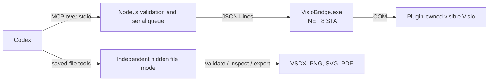

# Visio Scientific Illustrator

English | [简体中文](README.md)

Visio Scientific Illustrator is a Windows-only Codex plugin for creating editable scientific diagrams live in a visible Microsoft Visio window. Codex creates native Visio text, shapes, images, groups, containers, freeform paths, and glued connectors step by step, then saves an editable `.vsdx` deliverable and exports previews.

It does not use system mouse/keyboard automation and does not generate a VSDX before opening it. Each controlled object has a stable `User.CodexId` semantic ID for inspection, local updates, and fidelity checks.

## Features

- Draw visible, step-by-step scientific figures with a configurable delay.
- Create editable text, rich-text formulas, 2D shapes, native Geometry paths, layers, groups, containers, and scientific components.
- Create one-dimensional Visio connectors whose endpoints are verified with real `GlueTo` records.
- Compile draw.io blueprints into an editable Scientific SceneGraph and render it region by region.
- Compare regional previews with a reference image using MAE, edge, coverage, and color-difference metrics.
- Save VSDX files through a validated staging workflow; export PNG, SVG, or PDF from an independent file session.

## Architecture



`visio-live` controls only a plugin-owned visible Visio process. `visio-file-utils` validates, inspects, compares, and exports saved VSDX files in an independent hidden process. Both services communicate locally over child-process standard input/output and do not open a network port.

## Requirements

- Windows 10 or Windows 11 x64.
- Microsoft Visio desktop installed and started at least once; this release is validated with 64-bit Visio.
- Codex desktop app or Codex CLI with plugin support.
- Node.js 22 or newer.
- .NET 8 SDK only when building the Bridge from source.

Visio for the web, macOS, Linux, and installations without the `Visio.Application` COM class are not supported.

## Installation

Clone this repository and enter its root directory:

```powershell
git clone https://github.com/ShuWisensing/Visio-Scientific-Illustrator.git
Set-Location Visio-Scientific-Illustrator
```

Build the Bridge if `plugins/visio-scientific-illustrator/bin/win-x64/VisioBridge.exe` is absent or its source changed:

```powershell
npm run build:bridge
```

Install the local marketplace and plugin:

```powershell
powershell -ExecutionPolicy Bypass -File .\install.ps1 -InstallDir (Get-Location).Path
```

If PowerShell cannot execute the Codex binary discovered in the protected WindowsApps directory, use the official temporary npm CLI instead:

```powershell
npx --yes @openai/codex@latest plugin marketplace add (Get-Location).Path
npx --yes @openai/codex@latest plugin add visio-scientific-illustrator@visio-scientific-tools
```

Restart Codex completely and start a new task. The installed plugin ID is `visio-scientific-illustrator@visio-scientific-tools`. After updating the repository, rebuild the Bridge, reinstall, and restart Codex.

## Quick start

Restart Codex, create a new task, attach a reference image if applicable, and use a prompt such as:

```text
Use Visio Scientific Illustrator. Recreate this reference figure step by step
in a visible Microsoft Visio page. Wait 500 ms between drawing operations.
Keep all text, shapes, and connectors editable, and make every connector
endpoint genuinely glued. Export and inspect a preview after each logical
region. Do not use system mouse/keyboard automation and do not generate a
VSDX before opening it. Save the result to E:\figures\result.vsdx, validate
it, and export a 2000 px-wide PNG.
```

The normal workflow is:

1. `visio_live_launch` creates or opens a plugin-owned visible Visio document.
2. Add shapes, images, and glued connectors; use `visio_live_draw_sequence` for paced batches.
3. Export `visio_live_preview` after each logical region and inspect the live page.
4. Use `visio_live_save` to create the VSDX safely.
5. Validate and export PNG, SVG, or PDF with file-mode tools.
6. Close with an explicit `dirty_action` or `visio_live_shutdown`.

## Tool reference

### Live Visio tools

| Tool | Purpose |
|---|---|
| `visio_live_launch` | Create or open a plugin-owned visible Visio document. |
| `visio_live_add_shape` / `visio_live_add_image` | Add editable 2D shapes, text, or local images. |
| `visio_live_add_path` / `visio_live_update_path` | Create or update native editable Visio Geometry paths. |
| `visio_live_add_connector` | Add a one-dimensional connector and glue both endpoints. |
| `visio_live_draw_sequence` | Execute ordered operations with a visible delay. |
| `visio_live_inspect` / `visio_live_preview` | Inspect IDs/connections or export a temporary PNG preview. |
| `visio_live_save` | Safely save a validated editable VSDX. |
| `visio_live_draw_scene` | Render a Scientific SceneGraph by regions and checkpoints. |
| `visio_live_add_scientific_component` | Create editable tensor cubes, waveforms, video stacks, routers, skeletons, and more. |
| `visio_live_group_shapes`, `visio_live_assign_layer`, `visio_live_add_to_container` | Use native Visio grouping, layers, and containers. |
| `visio_live_get_cells` / `visio_live_set_cells` | Read/write an allowlisted subset of ShapeSheet cells. |

### File tools

| Tool | Purpose |
|---|---|
| `visio_validate` | Reopen and validate a saved VSDX in hidden read-only mode. |
| `visio_inspect_file` | Inspect pages, shapes, IDs, and connections in a saved file. |
| `visio_export` | Export PNG, SVG, or PDF using Visio APIs. |
| `visio_compile_drawio_scene` | Compile draw.io diagrams into a Scientific SceneGraph without creating a VSDX. |
| `visio_compare_preview` | Compare a candidate preview to a reference image and optionally emit a heat map. |
| `visio_validate_fidelity` | Check IDs, exact text, primitive budget, grouping, and endpoint glue against a SceneGraph. |

All file paths must be absolute. Schemas reject unknown fields and return stable error codes with `retryable` and optional `details` fields.

## Scientific SceneGraph example

`visio_live_draw_scene` draws a complete scene directly in visible Visio. It does not pre-create a VSDX. `step_delay_ms` controls the pause after each visible operation.

```json
{
  "scene": {
    "scene_id": "wifi_pipeline",
    "canvas": { "width_px": 1600, "height_px": 900, "dpi": 96 },
    "style_tokens": {},
    "layers": ["background", "content", "annotation"],
    "nodes": [{
      "kind": "shape",
      "semantic_id": "encoder",
      "bounds": { "x": 560, "y": 280, "width": 230, "height": 150 },
      "layer": "content",
      "shape": "rounded_rectangle",
      "label": "Feature Encoder"
    }],
    "connectors": [],
    "regions": [{
      "id": "acquisition",
      "bounds": { "x": 0, "y": 0, "width": 850, "height": 900 },
      "checkpoint": true
    }]
  },
  "step_delay_ms": 500,
  "existing_policy": "error"
}
```

Regions run in declaration order. A checkpoint returns its preview and completed-step information. Use `start_region`, `end_region`, or `stop_after_checkpoint` for assisted review.

## Safety and limitations

- The Bridge owns only the Visio process it starts; it never attaches to or closes an existing user-owned Visio process.
- The plugin does not use mouse/keyboard automation, screenshot clicking, telemetry, or a hosted backend.
- Pictures are editable image objects, but pixels inside an image are not editable Visio geometry.
- Rich-text formulas remain editable. Fully typeset SVG/EMF formula content is not editable as Visio text.
- The current release supports VSDX input and PNG, SVG, and PDF output.

## Troubleshooting

| Error | Resolution |
|---|---|
| `VISIO_NOT_INSTALLED` | Install Microsoft Visio desktop and verify COM registration. |
| `BRIDGE_NOT_FOUND` | Run `npm run build:bridge`, then reinstall the plugin. |
| `VISIO_BUSY` | Finish the active Visio dialog, drag, or cell edit, then retry. |
| `SESSION_INVALIDATED` | The plugin-owned Visio process was closed; start a new live session. |
| `OUTPUT_EXISTS` | Use a new absolute output path or explicitly set `overwrite: true`. |
| Plugin is not visible | Fully restart Codex and start a new task. |

## Development

```powershell
npm test
npm run test:fidelity
dotnet test plugins\visio-scientific-illustrator\bridge\VisioBridge.sln -c Release
powershell -ExecutionPolicy Bypass -File .\scripts\build-stencil.ps1
npm run build:bridge
```

`npm test` runs syntax, repository-structure, MCP smoke, Node, and Bridge unit tests. The full .NET solution also runs Visio integration tests on Windows computers with Visio installed.

## License

MIT. This project evolved from the plugin organization and live-collaboration approach of [`icebird1998/drawio-scientific-illustrator`](https://github.com/icebird1998/drawio-scientific-illustrator). The Visio COM Bridge, Visio-specific tools, and Visio skill are implemented in this repository.
