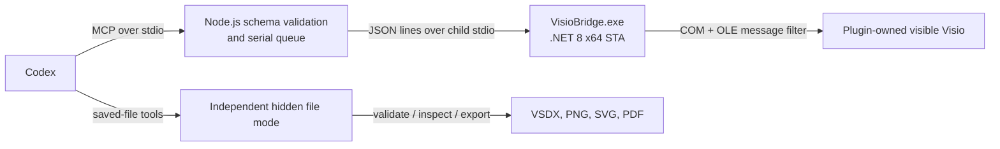

# Visio Scientific Illustrator

Visio Scientific Illustrator 是一个仅支持 Windows 的 Codex 插件。它让 Codex 通过 Microsoft Visio 的 COM 自动化接口，在用户可见的 Visio 窗口中逐步绘制科研示意图，并交付可继续编辑的 `.vsdx` 文件，而不是先生成静态图片或文件包再打开。

绘制得到的文字、二维形状、图片、分组、容器和一维连接线都是真实的 Visio 对象；连接线端点使用 `GlueTo` 粘附到目标形状。每个受控对象都使用 `User.CodexId` 保存稳定语义 ID，便于后续检查和局部修改。

## Architecture



插件包含两个 MCP 服务：

- `visio-live`：启动插件自有的可见 Visio 进程，按顺序添加、检查和修改对象。
- `visio-file-utils`：在独立的隐藏 Visio 进程中校验、检查和导出已经保存的 VSDX。

Node.js 层负责严格参数校验、拒绝未知字段和串行化所有状态修改；C# Bridge 在一个 STA 线程中执行 COM 调用，并通过有限的 OLE 重试策略处理 Visio 暂时忙碌的情况。两层只通过子进程标准输入输出通信，不监听网络端口。

## Requirements

- Windows 10 或 Windows 11 x64。
- 已安装并完成首次启动的 Microsoft Visio 桌面版；当前构建和验收环境为 64 位 Visio。
- 支持插件的 Codex 桌面应用或 Codex CLI。
- Node.js 22 或更高版本。
- 从源码构建 Bridge 时需要 .NET 8 SDK；使用已包含 `VisioBridge.exe` 的发布包时不需要 SDK。

Visio 网页版、macOS、Linux 和未注册 `Visio.Application` COM 类的精简安装不受支持。

## Install

### 安装当前本地仓库

在 PowerShell 中进入仓库根目录。若 `plugins/visio-scientific-illustrator/bin/win-x64/VisioBridge.exe` 尚不存在，先构建 Bridge：

```powershell
npm run build:bridge
```

然后运行安装器：

```powershell
powershell -ExecutionPolicy Bypass -File .\install.ps1 -InstallDir (Get-Location).Path
```

安装器会检查 Windows、Node.js 版本、Visio COM 注册、Codex CLI、Marketplace 元数据和 Bridge 可执行文件，然后注册本地 Marketplace 并安装：

```text
visio-scientific-illustrator@visio-scientific-tools
```

安装完成后必须重启 Codex，并新建一个任务，新的 Skill 和 MCP 服务才会被加载。

### 从源码安装

```powershell
git clone <仓库地址> visio-illustrator
Set-Location visio-illustrator
npm run build:bridge
powershell -ExecutionPolicy Bypass -File .\install.ps1 -InstallDir (Get-Location).Path
```

更新代码后，重新执行构建和安装命令，再重启 Codex。

## How to use

重启 Codex 后，新建任务并上传参考图，或直接描述要绘制的结构。推荐明确要求使用插件、可见逐步绘制、步进间隔、画布尺寸和交付格式。

示例提示词：

```text
使用 Visio Scientific Illustrator。在可见的 Microsoft Visio 页面中逐步重绘这张参考图，
每个绘制步骤间隔 500 ms。所有文字、形状和连接线都要保持可编辑，连接线端点必须真正粘附。
每完成一个逻辑区域就导出预览并检查；不要使用系统鼠标键盘自动化，也不要先生成 VSDX 再打开。
完成后保存为 E:\figures\result.vsdx，校验文件，并导出宽度 2000 px 的 PNG。
```

一个典型实时流程是：

1. `visio_live_launch` 新建或打开插件自有文档，并显示 Visio。
2. 先添加形状和图片，再添加粘附连接线；复杂批次使用 `visio_live_draw_sequence` 设置可见步进间隔。
3. 每个逻辑区域完成后用 `visio_live_preview` 检查页面。
4. 用户可能手工修改后，先调用 `visio_live_inspect`，再只更新明确要求的字段。
5. 用 `visio_live_save` 安全保存 VSDX，再用文件工具校验和导出。
6. 使用带明确 `dirty_action` 的关闭或关机工具结束插件会话。

## Tool reference

实时工具：

| 工具 | 作用 |
|---|---|
| `visio_live_launch` | 新建或打开插件自有的可见 Visio 文档 |
| `visio_live_status` | 返回会话、文档、页面和对象计数 |
| `visio_live_clear` | 经确认后以一个撤销单元清空当前页 |
| `visio_live_add_shape` | 添加可编辑二维形状或文本 |
| `visio_live_add_image` | 导入本地 PNG、JPEG、SVG 或 EMF |
| `visio_live_add_connector` | 添加并粘附一维连接线 |
| `visio_live_update_shape` | 仅修改显式提供的字段 |
| `visio_live_delete_shape` | 按明确的连接线策略删除对象 |
| `visio_live_draw_sequence` | 按顺序执行带可见间隔的操作，首次失败即停止 |
| `visio_live_inspect` | 检查当前页的对象、语义 ID 和连接关系 |
| `visio_live_fit` | 使窗口适配整页或页宽 |
| `visio_live_preview` | 导出并返回临时 PNG 页面预览 |
| `visio_live_save` | 安全保存并重新校验可编辑 VSDX |
| `visio_live_close_document` | 按 `save`、`discard` 或 `cancel` 关闭文档 |
| `visio_live_shutdown` | 经确认后只关闭插件自有 Visio 进程 |
| `visio_live_group_shapes` | 将顶层对象组合并保留成员语义 ID |
| `visio_live_ungroup_shape` | 取消组合并保留成员语义 ID |
| `visio_live_add_to_container` | 将对象加入真实 Visio 容器 |

文件工具：

| 工具 | 作用 |
|---|---|
| `visio_validate` | 以只读、隐藏方式重新打开并校验 VSDX |
| `visio_inspect_file` | 检查已保存文件的页面、对象和连接关系 |
| `visio_export` | 使用 Visio 原生接口导出 PNG、SVG 或 PDF |

所有文件路径必须是绝对路径。输入对象严格拒绝未知字段；错误以稳定错误码、`retryable` 和可选 `details` 返回。

## COM and process ownership

- 每个实时会话只创建一个插件自有的 `Visio.InvisibleApp`，随后把该实例设为可见。
- Bridge 从该实例主窗口句柄解析实际 Windows PID；不会调用 `GetActiveObject`，不会附着到已有 Visio，也不会枚举并接管用户进程。
- 所有 COM 调用都在同一个 STA 线程中执行。只有 `RPC_E_CALL_REJECTED` 和 `RPC_E_SERVERCALL_RETRYLATER` 会按 250 ms、最长 10 秒处理，耗尽后返回可重试的 `VISIO_BUSY`。
- 正常关闭只退出插件拥有的实例。用户预先打开的其他 Visio 窗口不在控制范围内。
- 请使用 `visio_live_shutdown` 做确定性关闭；异常退出时应先检查仍可见的文档并手工保存。

## Save and export safety

- 新建文档只有在可见页面已经绘制内容后才应执行最终保存。
- 覆盖现有 VSDX 前会创建同目录备份；保存后通过独立隐藏 Visio 重新打开校验。失败时恢复旧文件，并在错误详情中报告 `restored`。
- PNG/SVG 导出使用 `Page.Export`，PDF 使用 `Document.ExportAsFixedFormat`。
- 导出先写入临时文件并校验签名或尺寸，再原子替换目标；失败不会用空文件覆盖已有输出。
- 预览导出完成后会恢复 Visio 原有的栅格导出设置，并清理插件拥有的临时预览文件。

## Troubleshooting

- `VISIO_NOT_INSTALLED`：确认安装的是 Microsoft Visio 桌面版，并能在 PowerShell 中解析 `[type]::GetTypeFromProgID("Visio.Application")`。
- `BRIDGE_NOT_FOUND`：在仓库根目录执行 `npm run build:bridge`，再重新安装。
- `VISIO_BUSY`：结束 Visio 当前的对话框、拖拽或单元格编辑，稍后重试同一工具。
- `SESSION_INVALIDATED`：插件自有 Visio 被手工关闭或 COM 会话失效；保存可恢复内容后启动新会话。
- `OUTPUT_EXISTS`：明确设置 `overwrite: true`，或选择新的绝对输出路径。
- `MASTER_NOT_FOUND`：检查 `assets/visio-scientific-masters.vssx` 是否随插件完整安装；插件不会换用其他形状兜底。
- 安装后看不到插件：完全退出并重启 Codex，然后创建新任务。

## Known limitations

- 当前版本仅发布 `win-x64` Bridge，并仅针对 Microsoft Visio 桌面版验收。
- 连接线使用 Visio 动态路由和真实粘附端点；MCP 0.1.0 尚未提供显式折线路点参数。
- 照片、显微图、热图和复杂渲染可作为图片对象插入，但图片内部像素不是可编辑的 Visio 几何图元。
- 科研专用 Master 集合是固定白名单；缺少 Master 时会明确报错，不自动替换。
- 文件模式支持 VSDX 输入以及 PNG、SVG、PDF 输出，不支持旧版 VSD、JPG 或第三方格式转换。

## Security and privacy

- 不监听网络端口，不包含遥测或托管后端。
- Node MCP 与 Bridge 只通过子进程标准输入输出交换 JSON。
- 不使用系统级鼠标、键盘、截图点击或通用窗口自动化。
- 参考文件、VSDX 和预览保留在本机，除非用户另行上传。
- 临时文件只在插件自有的会话目录和目标文件旁的受控临时路径中创建。详见 [PRIVACY.md](PRIVACY.md)。

## Development and tests

```powershell
npm test
dotnet test plugins\visio-scientific-illustrator\bridge\VisioBridge.IntegrationTests\VisioBridge.IntegrationTests.csproj -c Release --filter "Category=VisioIntegration"
npm run build:bridge
```

`npm test` 包含源码语法检查、仓库结构校验、两个 MCP 服务的协议冒烟测试、Node 单元测试和不依赖本机 Visio 的 Bridge 单元测试。标记为 `VisioIntegration` 的测试会实际启动可见或隐藏 Visio，只应在装有 Visio 的 Windows 开发机运行。

核心源码位于 `plugins/visio-scientific-illustrator/`。发布前还应执行插件清单验证和 Skill 规范校验。

## License

MIT。该项目由 `icebird1998/drawio-scientific-illustrator` 的插件组织方式和实时协作思路演化而来，Visio COM Bridge、工具协议和 Visio Skill 为本仓库实现。
