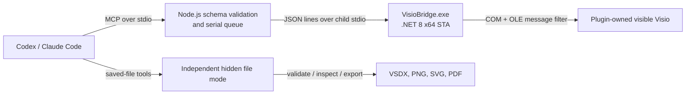

# Visio Scientific Illustrator

[English](README.en.md) | 简体中文

Visio Scientific Illustrator 是一个仅支持 Windows、同时兼容 Codex 和 Claude Code 的插件。它让模型通过 Microsoft Visio 的 COM 自动化接口，在用户可见的 Visio 窗口中逐步绘制科研示意图，并交付可继续编辑的 `.vsdx` 文件，而不是先生成静态图片或文件包再打开。

绘制得到的文字、二维形状、图片、分组、容器和一维连接线都是真实的 Visio 对象；连接线端点使用 `GlueTo` 粘附到目标形状。每个受控对象都使用 `User.CodexId` 保存稳定语义 ID，便于后续检查和局部修改。

## Architecture



插件包含两个 MCP 服务：

- `visio-live`：启动插件自有的可见 Visio 进程，按顺序添加、检查和修改对象。
- `visio-file-utils`：在独立的隐藏 Visio 进程中校验、检查和导出已经保存的 VSDX。

Node.js 层负责严格参数校验、拒绝未知字段和串行化所有状态修改；C# Bridge 在一个 STA 线程中执行 COM 调用，并通过有限的 OLE 重试策略处理 Visio 暂时忙碌的情况。两层只通过子进程标准输入输出通信，不监听网络端口。

## Requirements

- Windows 10 或 Windows 11 x64。
- 已安装并完成首次启动的 Microsoft Visio 桌面版；当前构建和验收环境为 64 位 Visio。
- 支持插件的 Codex 桌面应用、Codex CLI，或 Claude Code 2.1.218 及更高版本。
- Node.js 22 或更高版本。
- 从源码构建 Bridge 时需要 .NET 8 SDK；使用已包含 `VisioBridge.exe` 的发布包时不需要 SDK。

Visio 网页版、macOS、Linux 和未注册 `Visio.Application` COM 类的精简安装不受支持。

## Install

仓库采用单一插件目录和双平台清单：Codex 与 Claude Code 共享同一个 Skill、MCP 实现、COM Bridge、Visio 模板和资源，不需要维护两份绘图代码。

### Codex

```powershell
git clone https://github.com/TZ-mx/Visio-Illustrator.git
Set-Location Visio-Illustrator
.\install.ps1
```

安装完成后完全退出并重启 Codex，再新建任务。如果 Codex 桌面版位于受保护的 WindowsApps 目录，PowerShell 无法执行自动发现到的 `codex.exe`，可改用官方临时 CLI：

```powershell
npx --yes @openai/codex@latest plugin marketplace add (Get-Location).Path
npx --yes @openai/codex@latest plugin add visio-scientific-illustrator@visio-scientific-tools
```

### Claude Code

先确认 `claude --version` 不低于 2.1.218，然后执行：

```powershell
git clone https://github.com/TZ-mx/Visio-Illustrator.git
Set-Location Visio-Illustrator
.\install-claude.ps1
```

安装器会严格验证 Marketplace、插件清单、Node.js、Visio COM 和 Bridge，然后以用户范围注册并安装 `visio-scientific-illustrator@visio-scientific-tools`。安装后在 Claude Code 中执行 `/reload-plugins`，或新建会话。

### 从源码构建 Bridge

发布仓库已经包含 `plugins/visio-scientific-illustrator/bin/win-x64/VisioBridge.exe`。只有该文件缺失或 Bridge 源码发生变化时才需要：

```powershell
npm run build:bridge
```

随后重新运行对应平台的安装器。

### 更新与卸载

拉取新版本后，Codex 重新执行 `.\install.ps1`；Claude Code 可重新执行 `.\install-claude.ps1`，或使用：

```powershell
claude plugin update visio-scientific-illustrator@visio-scientific-tools
```

卸载 Codex 插件及本地 Marketplace：

```powershell
codex plugin remove visio-scientific-illustrator@visio-scientific-tools
codex plugin marketplace remove visio-scientific-tools
```

卸载 Claude Code 插件及本地 Marketplace：

```powershell
claude plugin uninstall visio-scientific-illustrator@visio-scientific-tools --scope user
claude plugin marketplace remove visio-scientific-tools --scope user
```

## How to use

Codex：在插件选择器中选择 **Visio Scientific Illustrator**，然后直接描述参考图、输出目录、步进间隔和格式要求。

Claude Code：插件 Skill 名称为 `visio-scientific-illustrator:recreate-scientific-figure-in-visio`。可以让 Claude 自动选择，也可以显式输入 `/visio-scientific-illustrator:recreate-scientific-figure-in-visio`。

新建任务或会话后上传参考图，或直接描述要绘制的结构。推荐明确要求使用插件、可见逐步绘制、步进间隔、画布尺寸和交付格式。

示例提示词：

```text
使用 Visio Scientific Illustrator，在插件拥有的可见 Microsoft Visio 页面中
逐步重绘这张参考图。每步间隔 500 ms。文字、形状和连接线必须保持可编辑，
所有语义连接线的两端必须真正粘附。每完成一个逻辑区域就导出预览并检查，
不要使用系统鼠标键盘自动化，也不要先生成 VSDX 再打开。完成后保存 VSDX，
执行结构与保真校验，并导出宽度 2000 px 的 PNG。
```

一个典型实时流程是：

1. `visio_live_launch` 新建或打开插件自有文档，并显示 Visio。
2. 先添加形状和图片，再添加粘附连接线；复杂批次使用 `visio_live_draw_sequence` 设置可见步进间隔。
3. 每个逻辑区域完成后用 `visio_live_preview` 检查页面。
4. 用户可能手工修改后，先调用 `visio_live_inspect`，再只更新明确要求的字段。
5. 用 `visio_live_save` 安全保存 VSDX，再用文件工具校验和导出。
6. 使用带明确 `dirty_action` 的关闭或关机工具结束插件会话。

打开已有 VSDX 时可以提供 `page_name` 和 `canvas.dpi`。插件会绑定并显示指定页，画布像素尺寸由该页真实的 `PageWidth`、`PageHeight` 和请求 DPI 计算；后续操作不会因为用户切换页面而悄悄改绑到别页。

连接线支持以下 Visio 原生参数：

- `routing: "dynamic" | "right_angle" | "straight"`：使用 Visio 可路由一维连接线。
- `routing: "polyline"`：必须同时提供 1–64 个顶部左原点像素坐标 `waypoints`；折线路径仍是一个可编辑的一维 Visio Shape。
- `label`：设置连接线可编辑文字。
- `source_connection_point`、`target_connection_point`：按一基序号粘附到已有 `Connections.Xn`；不存在时返回 `CELL_NOT_FOUND`。
- `source` 与 `target` 必须是不同的语义 Shape；端点创建后会验证 `BeginX` 和 `EndX` 两条连接记录。

## Tool reference

实时工具：

| 工具 | 作用 |
|---|---|
| `visio_live_launch` | 新建或打开插件自有的可见 Visio 文档 |
| `visio_live_status` | 返回会话、文档、页面和对象计数 |
| `visio_live_clear` | 经确认后以一个撤销单元清空当前页 |
| `visio_live_add_shape` | 添加可编辑二维形状或文本 |
| `visio_live_add_image` | 导入本地 PNG、JPEG、SVG 或 EMF |
| `visio_live_add_path` / `visio_live_update_path` | 用 Visio Geometry 行创建或更新可编辑自由路径 |
| `visio_live_add_connector` | 添加并粘附一维连接线 |
| `visio_live_update_shape` | 仅修改显式提供的字段 |
| `visio_live_delete_shape` | 按明确的连接线策略删除对象 |
| `visio_live_draw_sequence` | 按顺序执行带可见间隔的操作，首次失败即停止 |
| `visio_live_inspect` | 检查当前页的对象、语义 ID 和连接关系 |
| `visio_live_fit` | 使窗口适配整页或页宽 |
| `visio_live_preview` | 导出并返回临时 PNG 页面预览 |
| `visio_live_save` | 安全保存并重新校验可编辑 VSDX |
| `visio_live_close_document` | 按 `save`、`discard` 或 `cancel` 关闭文档 |
| `visio_live_shutdown` | 经确认后只关闭插件自有 Visio 进程 |
| `visio_live_group_shapes` | 将顶层对象组合并保留成员语义 ID |
| `visio_live_ungroup_shape` | 取消组合并保留成员语义 ID |
| `visio_live_add_to_container` | 将对象加入真实 Visio 容器 |
| `visio_live_set_z_order` | 按语义 ID 精确调整前后层级 |
| `visio_live_assign_layer` | 创建或复用 Visio 图层并分配对象 |
| `visio_live_align_shapes` / `visio_live_distribute_shapes` | 使用 Visio 原生布局能力对齐、分布对象 |
| `visio_live_match_size` | 统一宽度、高度或两者 |
| `visio_live_set_protection` | 设置白名单内的 ShapeSheet Lock 单元格 |
| `visio_live_duplicate_shape` | 复制可编辑 Shape 并分配新的语义 ID |
| `visio_live_add_scientific_component` | 生成由可编辑图元组成的科研组件 |
| `visio_live_get_cells` / `visio_live_set_cells` | 读取或写入白名单内的 ShapeSheet 单元格 |
| `visio_live_add_connection_point` | 添加具名、归一化坐标连接点 |
| `visio_live_get_geometry` | 检查原生 Geometry section 和行公式 |
| `visio_live_draw_scene` | 按区域检查点逐步执行完整 Scientific SceneGraph |

文件工具：

| 工具 | 作用 |
|---|---|
| `visio_validate` | 以只读、隐藏方式重新打开并校验 VSDX |
| `visio_inspect_file` | 检查已保存文件的页面、对象和连接关系 |
| `visio_export` | 使用 Visio 原生接口导出 PNG、SVG 或 PDF |
| `visio_compile_drawio_scene` | 把 draw.io 图编译为 Scientific SceneGraph，不生成 VSDX |
| `visio_compare_preview` | 计算整图及分区域像素、边缘、覆盖率和颜色差异，并可导出热图 |
| `visio_validate_fidelity` | 对照 SceneGraph 校验语义 ID、精确文字、图元预算、组合和双端粘附 |

所有文件路径必须是绝对路径。输入对象严格拒绝未知字段；错误以稳定错误码、`retryable` 和可选 `details` 返回。

## High-fidelity API examples

### 富文本与公式

`visio_live_add_shape` 的 `label` 与 `rich_text` 二选一。字符区间采用零基 `start` 和 UTF-16 字符 `length`；上标与下标不能在同一个 run 中同时为真。下面的对象仍是一个可直接编辑的 Visio 文本 Shape：

```json
{
  "semantic_id": "loss_formula",
  "shape": "rectangle",
  "bounds": { "x": 620, "y": 80, "width": 260, "height": 72 },
  "style": {
    "fill": { "kind": "none" },
    "line": { "width_pt": 0 },
    "text_block": { "horizontal_align": "center", "vertical_align": "middle" }
  },
  "rich_text": {
    "text": "Ltotal = Lrec + βLKL",
    "runs": [
      { "start": 0, "length": 1, "font_family": "Cambria Math", "italic": true },
      { "start": 1, "length": 5, "font_family": "Cambria Math", "subscript": true },
      { "start": 15, "length": 1, "font_family": "Cambria Math", "color": "#B64040", "bold": true },
      { "start": 17, "length": 2, "font_family": "Cambria Math", "subscript": true }
    ],
    "fit": "shrink_text",
    "minimum_font_size_pt": 8
  }
}
```

富文本适合可编辑的普通数学标记。需要 Office 原生公式排版且允许把公式作为独立对象管理时，应先在受支持的 Office 流程中生成 SVG/EMF，再以独立图片 Shape 插入；插件不会把图片内字符伪装成可编辑文本。

### 自由路径

路径坐标相对于 `bounds` 左上角，以像素表示；`M/L/C/A/Z` 分别对应移动、直线、三次贝塞尔、椭圆弧和闭合。路径在 Visio 中保存为原生 Geometry section，不是字符画或位图：

```json
{
  "semantic_id": "motion_wave",
  "bounds": { "x": 100, "y": 220, "width": 320, "height": 90 },
  "sections": [{
    "closed": false,
    "filled": false,
    "commands": [
      { "op": "M", "x": 0, "y": 45 },
      { "op": "C", "x1": 45, "y1": 5, "x2": 75, "y2": 5, "x": 120, "y": 45 },
      { "op": "C", "x1": 165, "y1": 85, "x2": 205, "y2": 85, "x": 250, "y": 45 },
      { "op": "L", "x": 320, "y": 45 }
    ]
  }],
  "style": {
    "fill": { "kind": "none" },
    "line": { "color": "#2C78C4", "width_pt": 2.25, "cap": "round", "join": "round" }
  }
}
```

### Scientific SceneGraph

SceneGraph 用稳定语义 ID 统一画布、图层、节点、连接线和区域检查点。`visio_live_draw_scene` 直接在可见页面中执行它，不会先写 VSDX；`step_delay_ms` 是每个可见操作完成后的间隔：

```json
{
  "scene": {
    "scene_id": "wifi_pipeline",
    "canvas": { "width_px": 1600, "height_px": 900, "dpi": 96 },
    "style_tokens": {},
    "layers": ["background", "content", "annotation"],
    "nodes": [
      {
        "kind": "component",
        "semantic_id": "router",
        "bounds": { "x": 80, "y": 300, "width": 150, "height": 110 },
        "layer": "content",
        "role": "router",
        "parameters": { "primary_color": "#3978B8" }
      },
      {
        "kind": "shape",
        "semantic_id": "encoder",
        "bounds": { "x": 560, "y": 280, "width": 230, "height": 150 },
        "layer": "content",
        "shape": "rounded_rectangle",
        "label": "Feature Encoder"
      }
    ],
    "connectors": [{
      "semantic_id": "router_to_encoder",
      "source": "router",
      "target": "encoder",
      "routing": "right_angle",
      "glued": true,
      "style": { "stroke_color": "#52677A", "stroke_width_pt": 1.5, "end_arrow": "triangle" }
    }],
    "regions": [{
      "id": "acquisition",
      "bounds": { "x": 0, "y": 0, "width": 850, "height": 900 },
      "checkpoint": true
    }]
  },
  "step_delay_ms": 500,
  "existing_policy": "error"
}
```

区域按声明顺序执行。检查点返回区域、完成步骤和预览信息；可以用 `start_region`、`end_region` 继续指定区间，或用 `stop_after_checkpoint` 在人工审阅点暂停。

### 科研组件

`visio_live_add_scientific_component` 支持 `number_badge`、`router`、`human_silhouette`、`joint_skeleton`、`video_frame_stack`、`tensor_cube`、`latent_vector`、`waveform`、`snowflake`、`wireless_link` 和 `stage_panel`。每个组件由可编辑 Visio 子图元构成：

```json
{
  "semantic_id": "receiver_link",
  "component": "wireless_link",
  "bounds": { "x": 250, "y": 250, "width": 180, "height": 140 },
  "options": {
    "count": 4,
    "direction": "left",
    "primary_color": "#5B9F4A"
  }
}
```

### ShapeSheet 安全接口

高级接口只接受 schema 中的白名单单元格和强类型值，不接受任意 FormulaU、事件公式或 COM 对象：

```json
{
  "semantic_id": "encoder",
  "writes": [
    { "cell": "LockAspect", "value": true },
    { "cell": "Rounding", "value": { "number": 8, "unit": "pt" } },
    { "cell": "LineWeight", "value": { "number": 1.5, "unit": "pt" } }
  ]
}
```

如需确定可写名称和单位，应以工具输入 schema 为准；不在白名单内的单元格会直接拒绝，不会改写为近似实现。

### 从 draw.io 蓝图迁移并做保真验收

推荐链路是：`visio_compile_drawio_scene` → 审查/补充 SceneGraph → `visio_live_launch` → `visio_live_draw_scene` → 分区域 `visio_live_preview` 与 `visio_compare_preview` → `visio_live_save` → `visio_validate_fidelity` → `visio_export`。编译步骤只解析蓝图，不创建或打开 VSDX：

```json
{ "input_path": "E:\\figures\\source.drawio", "diagram_name": "Overview" }
```

```json
{
  "reference_path": "E:\\figures\\reference.png",
  "candidate_path": "E:\\figures\\preview.png",
  "heatmap_path": "E:\\figures\\difference.png",
  "regions": [
    { "id": "left", "x": 0, "y": 0, "width": 520, "height": 900 },
    { "id": "middle", "x": 520, "y": 0, "width": 560, "height": 900 }
  ]
}
```

视觉指标用于发现偏差，不单独决定通过；最终门禁同时检查可编辑图元数量、文字、组合结构、语义 ID 和连接线双端 GlueTo 记录。

## COM and process ownership

- 每个实时会话只创建一个插件自有的 `Visio.InvisibleApp`，随后把该实例设为可见。
- Bridge 从该实例主窗口句柄解析实际 Windows PID；不会调用 `GetActiveObject`，不会附着到已有 Visio，也不会枚举并接管用户进程。
- 所有 COM 调用都在同一个 STA 线程中执行。只有 `RPC_E_CALL_REJECTED` 和 `RPC_E_SERVERCALL_RETRYLATER` 会按 250 ms、最长 10 秒处理，耗尽后返回可重试的 `VISIO_BUSY`。
- 正常关闭只退出插件拥有的实例。用户预先打开的其他 Visio 窗口不在控制范围内。
- 请使用 `visio_live_shutdown` 做确定性关闭；异常退出时应先检查仍可见的文档并手工保存。

## Save and export safety

- 新建文档只有在可见页面已经绘制内容后才应执行最终保存。
- 保存时先把当前文档写入目标目录旁的受控 staging VSDX，并通过独立隐藏 Visio 重新打开校验；候选文件通过后，才用同卷原子替换把这份已验证字节提交到目标路径，同时保留旧文件备份。随后插件会在原有 Visio 实例中按原 Page ID 重新打开并激活目标页。候选校验失败时目标文件完全未触碰，提交失败时恢复旧文件，并在错误详情中报告 `restored`、`committed`、`phase` 和可继续抢救的 `recovery_path`。
- PNG/SVG 导出使用 `Page.Export`，PDF 使用 `Document.ExportAsFixedFormat`。
- 导出先写入临时文件并校验签名或尺寸，再原子替换目标；失败不会用空文件覆盖已有输出。
- 预览导出完成后会恢复 Visio 原有的栅格导出设置，并清理插件拥有的临时预览文件。

## Troubleshooting

- `VISIO_NOT_INSTALLED`：确认安装的是 Microsoft Visio 桌面版，并能在 PowerShell 中解析 `[type]::GetTypeFromProgID("Visio.Application")`。
- `BRIDGE_NOT_FOUND`：在仓库根目录执行 `npm run build:bridge`，再重新安装。
- `VISIO_BUSY`：结束 Visio 当前的对话框、拖拽或单元格编辑，稍后重试同一工具。
- `SESSION_INVALIDATED`：插件自有 Visio 被手工关闭或 COM 会话失效；保存可恢复内容后启动新会话。
- `OUTPUT_EXISTS`：明确设置 `overwrite: true`，或选择新的绝对输出路径。
- `MASTER_NOT_FOUND`：检查 `assets/visio-scientific-masters.vssx` 是否随插件完整安装；插件不会换用其他形状兜底。
- Codex 安装后看不到插件：完全退出并重启 Codex，然后创建新任务。
- Claude Code 安装后看不到插件：执行 `/reload-plugins` 或新建会话，再用 `claude plugin list --json` 与 `claude plugin details visio-scientific-illustrator@visio-scientific-tools` 检查状态。

## Known limitations

- 当前版本仅发布 `win-x64` Bridge，并仅针对 Microsoft Visio 桌面版验收。
- 不同 Visio 桌面版本对渐变方向、字体替换、字符上/下标和 Geometry 弧的渲染可能存在细微差异；能力探测不通过时返回 `CAPABILITY_NOT_AVAILABLE`，不会静默降级。
- 为保证目标文件与已验证候选完全一致，安全保存会关闭并重新打开当前文档，因此保存前的 Visio 撤销历史不会跨越这次保存保留。
- 显式连接点只引用目标 Shape 已存在的 `Connections.Xn`，不会自动创建或猜测缺失连接点。
- 照片、显微图、热图和复杂渲染可作为图片对象插入，但图片内部像素不是可编辑的 Visio 几何图元。
- 局部修改图片内容仍需回到图片源文件；插件只能移动、缩放、分层或替换整个图片 Shape。
- 复杂公式有两种明确模式：优先使用富文本 run 保留字符可编辑性；需要完整数学排版时插入 SVG/EMF，并接受其内部字符不再是 Visio 文本。
- ShapeSheet 高级写入仅覆盖公开白名单，不支持任意公式、事件、宏、外部链接或未声明单元格。
- 科研专用 Master 集合是固定白名单；缺少 Master 时会明确报错，不自动替换。
- 文件模式支持 VSDX 输入以及 PNG、SVG、PDF 输出，不支持旧版 VSD、JPG 或第三方格式转换。

## Security and privacy

- 不监听网络端口，不包含遥测或托管后端。
- Node MCP 与 Bridge 只通过子进程标准输入输出交换 JSON。
- 不使用系统级鼠标、键盘、截图点击或通用窗口自动化。
- 参考文件、VSDX 和预览保留在本机，除非用户另行上传。
- 临时文件只在插件自有的会话目录和目标文件旁的受控临时路径中创建。详见 [PRIVACY.md](PRIVACY.md)。

## Development and tests

```powershell
npm test
npm run test:fidelity
dotnet test plugins\visio-scientific-illustrator\bridge\VisioBridge.sln -c Release
powershell -ExecutionPolicy Bypass -File .\scripts\build-stencil.ps1
npm run build:bridge
```

`npm test` 包含源码语法检查、仓库结构校验、两个 MCP 服务的协议冒烟测试、Node 单元测试和不依赖本机 Visio 的 Bridge 单元测试。完整解决方案测试还会执行标记为 `VisioIntegration` 的保存重开、富文本、Geometry、组件和 GlueTo 用例；它们会实际启动可见或隐藏 Visio，只应在装有 Visio 的 Windows 开发机运行。构建发布包时先重新生成 stencil，再发布与插件 manifest 同版本的 self-contained `win-x64` Bridge。

核心源码位于 `plugins/visio-scientific-illustrator/`。发布前还应执行插件清单验证和 Skill 规范校验。

## License

MIT。该项目由 `icebird1998/drawio-scientific-illustrator` 的插件组织方式和实时协作思路演化而来，Visio COM Bridge、工具协议和 Visio Skill 为本仓库实现。
