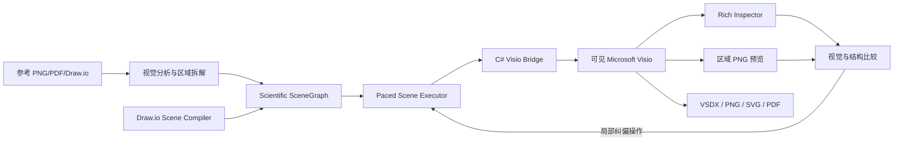

# Visio Scientific Illustrator 高保真增强实施计划

> **For agentic workers:** REQUIRED SUB-SKILL: Use `executing-plans` to implement this plan task-by-task. Steps use checkbox (`- [ ]`) syntax for tracking.

**Goal:** 将现有 Visio Scientific Illustrator 从“可稳定操作 Visio 的基础插件”升级为“能够在可见 Visio 页面中逐步构建细腻、丰富、接近参考模板的可编辑科研插图系统”。

**Architecture:** 保留 Node.js MCP、C#/.NET STA Bridge 和 Visio COM 三层结构，在其上新增统一科研图 `SceneGraph`、完整样式与富文本模型、自由几何与装饰路径、真实科学 Master、draw.io 场景编译器和视觉回归闭环。基础接口保持严格类型化；高级 ShapeSheet 能力通过受控单元格写入接口提供，不暴露无边界 COM 调用。

**Tech Stack:** Node.js 22、MCP JSON-RPC、C#/.NET 8、Microsoft Office Interop Visio、Visio ShapeSheet/Geometry/Characters API、xUnit、Node Test Runner、PNG 视觉比较。

---

## 1. 文档结论

当前结果失真不是因为 Microsoft Visio 不适合科研插图，而是因为插件只开放了 Visio 能力的一小部分，并且绘图 Skill 没有强制执行与原 draw.io 项目相同的高细节拆图策略。

本次增强不采用“增加几个 shape 类型”的局部修补。目标是建立完整绘图能力层，使插件同时具备：

1. 原 draw.io 项目已有的任意样式、富文本、曲线、锚点、路径点和逐步可视绘制能力。
2. Visio 特有的 ShapeSheet、Geometry Section、Characters、Connection Points、Master、容器、图层、动态连接、对齐分布和数据字段能力。
3. 面向科研插图的场景分解、图元预算、区域预览、视觉比较和纠偏规则。
4. 从现有 `.drawio` 矢量源编译为 Visio 操作序列的能力，但最终图形仍在可见 Visio 页面中逐步产生。
5. 对照片、视频帧、显微图等像素内容采用局部图片 Shape；禁止把整张图扁平化后伪装成可编辑结果。

实施后，Visio 接口在科研绘图相关能力上应当不弱于原 draw.io 接口，并在连接粘附、ShapeSheet、Master、容器、图层和版式工具方面更强。

## 2. 已确认问题与证据

### 2.1 当前接口表达能力过窄

当前 `ShapeStyle` 只有八项：

```text
fill_color
fill_transparency
stroke_color
stroke_width_pt
font_color
font_size_pt
rotation_deg
dashed
```

原 draw.io live server 则允许传入完整 mxGraph style 字符串，能够表达字体、粗体、斜体、上下标、渐变、圆角、阴影、透明度、线帽、对齐、HTML 文本、曲线和锚点。

缺失能力直接造成以下退化：

- 标题无法稳定使用粗体、字体族和精确对齐。
- 数学表达式退化为普通 ASCII 文本。
- 编号徽章、分区背景和模块卡片缺少渐变与细腻边框。
- 波形、骨架和张量只能被替换成字符或粗糙矩形。
- Inspect 无法返回完整格式，Codex 无法精确纠偏。

### 2.2 图元数量和细节密度不足

同内容 draw.io Fig.1 包含 273 个顶点和 59 条边；当前 Visio 结果只有 111 个 Shape 和 24 条连接线。draw.io 文件还包含 30 个渐变图形、24 个旋转图形、18 个 HTML 标签和多组曲线路径。

当前 Visio 版本使用 `GRID`、波浪字符和 ASCII 人体替代独立网格、自由曲线与关节骨架。这不是格式转换误差，而是绘图策略主动丢失信息。

### 2.3 Skill 与实际工具冲突

Skill 要求通过 `CellsU`、`FormulaU` 和 `NameU` 使用通用 ShapeSheet 名称，但 MCP 没有通用 ShapeSheet 操作。调用方只能使用 StyleMapper 内置的少量单元格。

因此必须在以下两个方向中选择一个，并保持一致：

- Skill 删除无法执行的要求；或
- Bridge/MCP 真正提供受控 ShapeSheet 能力。

本计划选择第二种方案。

### 2.4 科研 Master 名不副实

当前 stencil 构建脚本把 `Codex Cylinder` 和 `Codex Cloud` 都创建成普通椭圆。现有 Master 也没有视频帧堆叠、张量、人体骨架、路由器、波形、潜变量、雪花、网格和三维立方体。

Master 名称与实际几何不一致属于实现错误。增强版本禁止以错误基础图形替代缺失 Master。

### 2.5 语义连接线承担了不该承担的绘图职责

语义 Connector 必须连接两个不同 Shape 并真实 GlueTo，这一约束适用于流程关系，但不适用于：

- CSI 波形；
- 人体骨骼；
- 三维张量边线；
- 装饰分隔线；
- 冻结阶段虚线；
- 任意开放曲线。

必须新增独立的 `decorative_path`。语义 Connector 继续强制粘附，装饰路径则使用 Visio 原生 Geometry/Polyline，并保持节点可编辑。

### 2.6 视觉检查没有形成验收门禁

当前流程会导出预览，但没有：

- 参考图和预览图的同尺寸比较；
- 分逻辑区域检查；
- 文本完整性检查；
- 边缘结构召回检查；
- 图元数量与预估数量比较；
- 自动发现空白、重叠、遮挡和错误层级。

因此“文件有效”和“连接线已粘附”被错误地当成“重绘完成”。

## 3. 设计目标与边界

### 3.1 必须实现

- 可见 Visio 页面中逐步绘制，每个操作支持非零延迟。
- 所有标题、公式、标签、形状、路径和连接线保持 Visio 可编辑。
- 所有语义连接线两端真实粘附。
- 曲线、骨架、张量、网格和图标由可编辑图元构成。
- 支持局部图片 Shape，但仅限参考图中本来就是像素内容的区域。
- 逐区域导出预览，检查后继续绘制。
- 最终保存 VSDX、验证结构并导出 2000 px PNG。
- 现有稳定的会话、保存、覆盖保护、进程所有权和 COM busy 处理不得回退。

### 3.2 明确禁止

- 禁止用 ASCII 字符模拟人体、波形、雪花、天线、网格或张量。
- 禁止用一个标签字符承担本应由多个 Shape 表达的图形。
- 禁止用椭圆冒充圆柱或云形。
- 禁止把完整 PNG/SVG 作为最终单一 Shape 覆盖页面。
- 禁止先离线生成 VSDX 再打开伪装成实时绘制。
- 禁止因为接口暂时缺失而静默降级；必须返回明确能力错误。
- 禁止仅用全局 SSIM 作为相似度结论，因为大面积白底会虚高分数。
- 禁止为了缩短绘制时间而无依据减少图元数量。

### 3.3 完整性的含义

“尽可能完整”指覆盖科研插图需要的 Visio 绘制表面，而不是把整个 COM 对象模型无约束暴露给模型。接口分为三层：

1. **语义层**：标题、模块、张量、骨架、波形、视频帧堆叠等科研组件。
2. **图元层**：矩形、椭圆、多边形、线段、自由路径、文本、图片、连接线、组。
3. **ShapeSheet 层**：受控单元格、Geometry Row、Connection Point、Characters 和 Paragraph 格式。

常规绘图优先使用语义层或图元层；ShapeSheet 层用于精确控制和 Visio 原生增强。

## 4. 目标架构



### 4.1 Scientific SceneGraph

新增平台无关的场景描述，统一承载布局、样式、文字、路径、连接和层级。SceneGraph 不等于 VSDX，也不直接保存为最终文件；它被编译为在可见 Visio 中逐步执行的操作。

```json
{
  "scene_id": "figure1_sdmore",
  "canvas": { "width_px": 1817, "height_px": 866, "dpi": 96 },
  "style_tokens": {
    "font_primary": "Arial",
    "blue": "#0B4A8B",
    "green": "#216B2D",
    "orange": "#B64A00"
  },
  "layers": ["background", "panels", "content", "connectors", "labels", "annotations"],
  "nodes": [],
  "connectors": [],
  "regions": []
}
```

SceneGraph 负责：

- 稳定语义 ID；
- 像素坐标和页面尺寸；
- 父子、分组、图层和 Z-order；
- 共享样式 token；
- Shape、Text、Path、Image 和 Connector；
- 区域边界与预览检查点；
- 来源映射，例如原 draw.io cell ID。

### 4.2 能力分层

| 能力 | 当前实现 | 增强目标 |
|---|---|---|
| 填充 | 单色、透明度 | 无填充、单色、前后景、线性/径向渐变、图案、透明度 |
| 线条 | 颜色、宽度、虚线 | 线帽、圆角、透明度、自定义图案、箭头尺寸、复合线 |
| 文字 | 整体颜色与字号 | 字体族、粗斜体、上下标、局部字符区间、段落、边距、自动适配 |
| 几何 | 矩形、椭圆、少量 Master | 多边形、Polyline、Bezier、Arc、闭合自由路径、Geometry Section |
| 连接 | GlueTo、基本路由 | 连接点管理、动态/直角/直线、固定 waypoint、跳线、标签位置 |
| 组织 | 组、容器 | 图层、锁定、Z-order、对齐、分布、等尺寸、父子变换 |
| Master | 8 个基础名称 | 真实科研组件库、参数化组合组件、版本化 Master |
| 检查 | 基础 bounds/text | 完整样式、Characters、Geometry、图层、Z-order、连接点、公式摘要 |
| 视觉闭环 | 人工查看预览 | 区域裁剪、文字检查、边缘召回、颜色差异、重叠检测、迭代记录 |

## 5. 完整接口设计

### 5.1 丰富形状样式

替换单一 `ShapeStyle`，拆分为组合式样式：

```csharp
public sealed record ShapeStyle(
    FillStyle? Fill = null,
    LineStyle? Line = null,
    TextBlockStyle? TextBlock = null,
    ShadowStyle? Shadow = null,
    CornerStyle? Corner = null,
    double? RotationDeg = null,
    double? OpacityPercent = null);

public sealed record FillStyle(
    string Kind,
    string? Color = null,
    string? SecondaryColor = null,
    double? TransparencyPercent = null,
    double? SecondaryTransparencyPercent = null,
    double? GradientAngleDeg = null,
    int? GradientDirection = null,
    int? Pattern = null);

public sealed record LineStyle(
    string? Color = null,
    double? WidthPt = null,
    double? TransparencyPercent = null,
    int? Pattern = null,
    string? BeginArrow = null,
    string? EndArrow = null,
    string? BeginArrowSize = null,
    string? EndArrowSize = null,
    string? Cap = null,
    string? Join = null,
    bool? Rounded = null);
```

`FillStyle.Kind` 只接受 `none|solid|gradient|pattern`。所有颜色统一为 `#RRGGBB`，所有数值使用明确单位字段。未知属性拒绝，不静默忽略。

### 5.2 富文本和数学排版

新增 `RichText`，区分整段样式和字符区间：

```csharp
public sealed record RichText(
    string Text,
    TextParagraphStyle? Paragraph = null,
    IReadOnlyList<TextRun>? Runs = null,
    TextFitMode Fit = TextFitMode.None);

public sealed record TextRun(
    int Start,
    int Length,
    string? FontFamily = null,
    double? FontSizePt = null,
    string? Color = null,
    bool? Bold = null,
    bool? Italic = null,
    bool? Underline = null,
    bool? Strikethrough = null,
    bool? Superscript = null,
    bool? Subscript = null);

public sealed record TextParagraphStyle(
    string? HorizontalAlign = null,
    string? VerticalAlign = null,
    double? LeftMarginPt = null,
    double? RightMarginPt = null,
    double? TopMarginPt = null,
    double? BottomMarginPt = null,
    double? LineSpacingPt = null,
    double? SpaceBeforePt = null,
    double? SpaceAfterPt = null);
```

实现使用 `Shape.Characters.Begin/End` 选择字符区间，再写入 `Char.Font`、`Char.Size`、`Char.Style`、`Char.Color` 和位置相关单元格。上标和下标互斥，区间不得越界或重叠冲突。

公式不通过不可编辑截图实现。简单公式使用 RichText 字符区间；复杂公式提供两种明确模式：

- `editable_text`：Unicode 数学字符加上下标区间，完全可编辑。
- `vector_equation`：由外部公式渲染器生成 EMF/SVG 后作为局部矢量对象导入，并在结果中标记其文字不是 Visio Characters。

默认使用 `editable_text`。接口不允许在失败时自动切换模式。

### 5.3 自由路径和自定义几何

新增工具：

```text
visio_live_add_path
visio_live_update_path
```

路径命令：

```json
{
  "semantic_id": "dynamic_residual_wave",
  "closed": false,
  "commands": [
    { "op": "M", "x": 0, "y": 20 },
    { "op": "C", "x1": 20, "y1": 5, "x2": 40, "y2": 35, "x": 60, "y": 20 },
    { "op": "L", "x": 120, "y": 20 }
  ],
  "style": { "line": { "color": "#216B2D", "width_pt": 1.2 } }
}
```

支持 `M|L|C|A|Z`。二次 Bezier 在 SceneGraph 编译时精确转换为三次 Bezier。Visio 端使用 `DrawPolyline` 或 Geometry Section 行创建原生 Shape，不使用字符近似。

### 5.4 语义连接线和装饰路径分离

`visio_live_add_connector` 保留以下硬约束：

- source 与 target 必须存在且不同；
- BeginX 和 EndX 必须 GlueTo；
- 创建后通过 `Page.Connects` 验证两端；
- 失败时删除未完成 Connector 并返回错误。

增强字段：

```json
{
  "routing": "dynamic|right_angle|straight|polyline",
  "source_anchor": { "mode": "auto|connection_point|normalized", "row": 1, "x": 1.0, "y": 0.5 },
  "target_anchor": { "mode": "auto|connection_point|normalized", "row": 2, "x": 0.0, "y": 0.5 },
  "waypoints": [],
  "jump_style": "none|arc|gap|square",
  "label_position": 0.5,
  "avoid_shape_ids": []
}
```

骨架、波形、张量轮廓和装饰虚线必须使用 `visio_live_add_path`，不得伪造 source/target。

### 5.5 ShapeSheet 高级接口

新增受控工具：

```text
visio_live_get_cells
visio_live_set_cells
visio_live_add_connection_point
visio_live_get_geometry
```

写入合同：

```json
{
  "semantic_id": "panel_1",
  "writes": [
    { "cell": "Rounding", "value": { "kind": "length", "number": 8, "unit": "pt" } },
    { "cell": "FillGradientDir", "value": { "kind": "integer", "number": 0 } },
    { "cell": "LockAspect", "value": { "kind": "boolean", "boolean": true } }
  ]
}
```

安全规则：

- 普通调用只接受插件维护的通用单元格 allowlist。
- 数字、角度、长度、百分比、颜色、布尔和枚举由 Bridge 生成 `FormulaU`。
- 不接受包含 `CALLTHIS`、外部文档、文件路径、宏、事件公式或任意函数调用的输入。
- Geometry、Connection Points、User 和 Shape Data 使用专用合同，不通过任意公式字符串拼接。
- 任何单元格不存在时返回 `CELL_NOT_AVAILABLE`，不得跳过。

初始 allowlist 至少覆盖：

```text
PinX PinY Width Height Angle LocPinX LocPinY
FillPattern FillForegnd FillBkgnd FillForegndTrans FillBkgndTrans
FillGradientDir FillGradientAngle FillGradientEnabled
LinePattern LineColor LineWeight LineColorTrans LineCap
BeginArrow EndArrow BeginArrowSize EndArrowSize
Rounding ShdwPattern ShdwForegnd ShdwOffsetX ShdwOffsetY
Char.Font Char.Size Char.Color Char.Style Char.Position
Para.HorzAlign Para.IndLeft Para.IndRight Para.SpBefore Para.SpAfter Para.SpLine
VerticalAlign TxtPinX TxtPinY TxtWidth TxtHeight
LeftMargin RightMargin TopMargin BottomMargin
LockWidth LockHeight LockAspect LockMoveX LockMoveY LockRotate
ConFixedCode ShapeRouteStyle ConLineRouteExt
LayerMember NoObjHandles NoCtlHandles NoAlignBox
```

### 5.6 布局、图层和层级工具

新增：

```text
visio_live_set_z_order
visio_live_assign_layer
visio_live_align_shapes
visio_live_distribute_shapes
visio_live_match_size
visio_live_set_protection
visio_live_duplicate_shape
```

典型请求：

```json
{
  "semantic_ids": ["card_1", "card_2", "card_3"],
  "axis": "horizontal",
  "distribution": "equal_gap",
  "preserve_outer_bounds": true
}
```

这些工具使用 Visio 原生选择集或经过计算的精确坐标。操作前后返回每个 Shape 的 page-space bounds，便于视觉检查和撤销。

### 5.7 科研组合组件

真实 Master 和参数化组件分开处理：

- **Master**：稳定、可重复使用的 Visio 原生母版。
- **组件生成器**：根据参数创建一组普通 Shape，再赋予组语义 ID。

第一批组件：

| 组件 | 构成 |
|---|---|
| `number_badge` | 渐变圆、数字、外圈、阴影 |
| `router` | 机身、天线、LED、信号弧线 |
| `human_silhouette` | 头、躯干、四肢自由路径 |
| `joint_skeleton` | 关节点、彩色骨骼、可选标签 |
| `video_frame_stack` | 多层框、局部图片、层级偏移 |
| `tensor_cube` | 前表面网格、侧面、顶面、深度线 |
| `latent_vector` | 外框、节点、竖向省略号 |
| `waveform` | 可重复曲线路径、基线、标签 |
| `snowflake` | 六轴分支线，中心对称 |
| `wireless_link` | 多段信号弧线、颜色和方向 |
| `stage_panel` | 标题、圆角边框、主题色和内边距 |

组件生成器必须返回组 ID和所有子 Shape ID。子图元仍可单独编辑；组被取消后语义 ID不得重复。

### 5.8 完整 Inspect

`visio_live_inspect` 扩展返回：

```json
{
  "semantic_id": "stage_1",
  "shape_id": 42,
  "name_u": "Codex_stage_1",
  "kind": "group",
  "bounds": {},
  "rotation_deg": 0,
  "z_order": 12,
  "layers": ["panels"],
  "master_name_u": "Codex Stage Panel",
  "text": { "plain": "Stage 1", "runs": [] },
  "style": { "fill": {}, "line": {}, "text_block": {} },
  "geometry": { "section_count": 1, "row_count": 8, "closed": true },
  "connections": [],
  "group": { "parent": null, "children": [] },
  "protection": {},
  "source_metadata": { "drawio_cell_id": "mx-21" }
}
```

Inspector 只返回受支持的公式摘要，不执行公式，也不返回 COM RCW。

## 6. 从原 draw.io 项目继承的策略

以下能力必须等价迁移：

- 可见页面逐步绘制。
- 每个 Shape 有稳定 ID。
- 支持完整样式覆盖，但 Visio 版本改为强类型样式和受控 ShapeSheet。
- 支持曲线、waypoint、入口/出口锚点。
- 支持富文本标签。
- 支持创建、检查、更新和删除已有图元。
- 每完成一个逻辑区域导出预览。
- 先构建 Shape，再连接 Edge。
- 保存前检查图形模型，保存后验证文件。

不能直接迁移的部分及 Visio 替代方案：

| draw.io 能力 | 不直接复用原因 | Visio 实现 |
|---|---|---|
| 任意 mxGraph style 字符串 | Visio 没有 mxStyle | 强类型样式 + 受控 ShapeSheet |
| HTML label | Visio Shape.Text 不是 HTML | Characters + Paragraph 局部格式 |
| mxGeometry points | 数据结构不同 | Geometry Section / DrawPolyline |
| `insertVertex` | Visio 使用 Page/Shape COM | PrimitiveFactory / Master Drop |
| `insertEdge` | Visio 1D Shape 和 GlueTo | ConnectorService |
| CDP Graph inspect | Visio 非 Electron | COM Inspector |
| draw.io XML 保存 | VSDX 由 Visio 管理 | Document.Save/SaveAsEx |

## 7. Visio 特有的创新能力

### 7.1 自适应连接点

对常用模块自动添加四边中心和角部连接点。连接点存入 `Connections.Xn/Yn/DirX/DirY`，并使用稳定 row tag。Codex 可以指定“右侧上部”等语义锚点，而不是猜测 row number。

### 7.2 参数化科学组件

组件不是一张导入图，而是由参数生成的 Visio Shape 组。例如 `tensor_cube` 接受：

```json
{
  "rows": 5,
  "columns": 5,
  "depth": 4,
  "front_color": "#D9E8FB",
  "side_color": "#F7E7B4",
  "grid_color": "#4A79A8"
}
```

它生成前、上、侧三个平面和全部网格线，保持独立可编辑。

### 7.3 主题 token 与批量重排

SceneGraph 样式 token 映射为文档级主题或 Shape Data。修改主题色时，只更新引用该 token 的 Shape，不覆盖用户手动修改过的局部样式。

### 7.4 双层视觉检查

- 结构层：Shape 数量、区域覆盖、文本、连接、层级、样式完整性。
- 图像层：区域裁剪、边缘召回、颜色差异、轮廓重合、空白和遮挡。

全局相似度仅作提示。最终判定以区域结构和人工视觉检查共同决定。

### 7.5 可追踪来源

每个 Shape 可以记录：

```text
User.CodexId
User.CodexRole
User.CodexRegion
User.CodexSourceType
User.CodexSourceId
User.CodexStyleToken
```

这样可从 Visio Shape 追溯到参考区域、draw.io cell 或组件生成器，便于局部重绘。

## 8. 高保真绘图 Skill 重写规则

### 8.1 绘图前

1. 读取参考图原始分辨率，不使用聊天缩略图代替。
2. 如果存在 `.drawio`、SVG、PPTX、PDF 或其他矢量源，优先检查其结构。
3. 划分逻辑区域，记录每个区域的边界、标题、主要图元、连接关系、颜色和预计图元数。
4. 建立全局 style token：字体、标题字号、正文大小、主题色、边框宽度、圆角和间距。
5. 为照片、视频帧和热图区分 `raster_content` 与 `editable_overlay`。

### 8.2 绘图中

1. 按背景、面板、内容、连接线、标签、装饰的顺序构建。
2. 每个复杂对象拆成真实图元，不允许字符画代理。
3. 每完成一个区域立即 Preview，不积累到整页结束。
4. 预览不合格时只修改对应区域，并在修改前 Inspect。
5. 所有新操作遵循 `step_delay_ms`；批量场景也逐项提交并刷新 Visio UI。
6. 优先保真度，其次才是绘制时间。图元多不是失败条件。

### 8.3 图元预算

绘制前为每个区域估算最低图元数量。实际数量低于估算的 80% 时，必须说明缺少哪些细节并继续拆分，不能直接完成。

对 Fig.1 的最低建议：

| 区域 | 最低图元数 | 必须保留的细节 |
|---|---:|---|
| 1. Data Collection and Preprocessing | 120 | 双链路、路由器、人体、两条处理流水线、视频帧、三张缓存卡片、张量、骨架 |
| 2. Static-Dynamic CSI Feature Decomposition | 75 | 两组波形、基线/残差、特征块、八通道张量、三个处理阶段 |
| 3. Two-Stage Training and Inference | 95 | 两个 Stage、视频堆叠、潜变量、冻结标志、张量、双输出分支、骨架 |
| 跨区背景、徽章、标题、连接和说明 | 35 | 三色主题、编号徽章、分隔和跨区视觉一致性 |

整页目标不少于 325 个顶层和子图元。该数值是当前参考图的保真门槛，不是所有科研图的固定常数。

### 8.4 局部图片政策

参考图中的真实视频画面可以作为局部 Image Shape，以保留像素真实性。必须同时满足：

- 图片只覆盖视频帧内部区域；
- 帧边框、堆叠、标题和连接线仍为 Visio 图元；
- Image Shape 可移动、缩放、裁剪和替换；
- Inspect 和最终交付列出图片 Shape 数量；
- 用户要求全矢量时，改用人体轮廓与房间线条重绘，不自动切换。

### 8.5 完成门禁

以下条件全部满足才能声明完成：

- 文本逐项核对，无 ASCII 公式替代。
- 所有语义 Connector 两端真实粘附。
- 所有波形、骨架和张量为图元或明确组件。
- 区域外框、标题、编号、颜色和相对比例与参考一致。
- 无意外遮挡、裁切、越界、重叠文字和错误 Z-order。
- 实际图元数量达到区域预算。
- 每个区域至少有一次预览检查记录。
- VSDX 可重新打开并通过 Validate。
- 2000 px PNG 可解码且宽度正确。

## 9. 视觉比较与验收设计

新增 `visio_compare_preview` 文件工具：

```json
{
  "reference_path": "E:\\figures\\reference.png",
  "preview_path": "E:\\figures\\preview.png",
  "regions": [
    { "id": "panel_1", "x": 0, "y": 0, "width": 707, "height": 852 }
  ]
}
```

输出：

```json
{
  "canvas": { "aspect_ratio_error": 0.001 },
  "global": { "mae": 0.09, "edge_precision": 0.50, "edge_recall": 0.46, "edge_f1": 0.48 },
  "regions": [],
  "warnings": []
}
```

### 9.1 自动检查项

- 宽高比误差不超过 0.5%。
- 主分区边界位置误差不超过画布宽高的 1.5%。
- 文字内容通过 SceneGraph 与 Inspect 精确比对。
- Edge recall 用于检测细节丢失，不能只看 SSIM。
- 连续迭代的区域 Edge F1 不得无解释下降超过 0.02。
- 颜色使用 Lab 色差计算主题色偏差。
- 检测文本框越界、Shape 越页、零尺寸、完全遮挡和重复语义 ID。

### 9.2 人工检查项

- 图是否仍有“字符画感”；
- 图形是否有合理的视觉重量和留白；
- 人体、张量、视频帧和波形是否足够细腻；
- 标题、公式和上下标是否像论文图而不是流程图默认样式；
- 三个主区域是否保持蓝、绿、橙的统一视觉语言。

## 10. 文件结构调整

### 10.1 新增文件

```text
plugins/visio-scientific-illustrator/bridge/VisioBridge.Contracts/
├─ SceneContracts.cs
├─ StyleContracts.cs
├─ TextContracts.cs
├─ PathContracts.cs
├─ ShapeSheetContracts.cs
└─ LayoutContracts.cs

plugins/visio-scientific-illustrator/bridge/VisioBridge.Core/
├─ Scenes/SceneExecutor.cs
├─ Styling/FillStyleMapper.cs
├─ Styling/LineStyleMapper.cs
├─ Styling/TextStyleMapper.cs
├─ Styling/ShapeSheetWriter.cs
├─ Text/RichTextFormatter.cs
├─ Shapes/FreeformBuilder.cs
├─ Shapes/ScientificComponentFactory.cs
├─ Shapes/ConnectionPointService.cs
├─ Layout/LayoutService.cs
├─ Inspection/StyleInspector.cs
├─ Inspection/GeometryInspector.cs
├─ Import/DrawioSceneCompiler.cs
└─ Validation/FidelityValidator.cs

plugins/visio-scientific-illustrator/bridge/VisioBridge.Tests/
├─ RichTextFormatterTests.cs
├─ ShapeSheetWriterTests.cs
├─ FreeformBuilderTests.cs
├─ ScientificComponentFactoryTests.cs
├─ SceneExecutorTests.cs
├─ DrawioSceneCompilerTests.cs
└─ FidelityValidatorTests.cs

plugins/visio-scientific-illustrator/scripts/
├─ scene-schema.mjs
└─ visual-compare.mjs
```

### 10.2 修改文件

```text
plugins/visio-scientific-illustrator/scripts/tool-schemas.mjs
plugins/visio-scientific-illustrator/scripts/live-server.mjs
plugins/visio-scientific-illustrator/scripts/file-server.mjs
plugins/visio-scientific-illustrator/bridge/VisioBridge.Contracts/ShapeCommands.cs
plugins/visio-scientific-illustrator/bridge/VisioBridge.Contracts/ConnectorCommands.cs
plugins/visio-scientific-illustrator/bridge/VisioBridge.Contracts/Inspection.cs
plugins/visio-scientific-illustrator/bridge/VisioBridge.Core/Commands/CommandRouter.cs
plugins/visio-scientific-illustrator/bridge/VisioBridge.Core/Session/VisioSession.cs
plugins/visio-scientific-illustrator/bridge/VisioBridge.Core/Shapes/ShapeFactory.cs
plugins/visio-scientific-illustrator/bridge/VisioBridge.Core/Shapes/ShapeEditor.cs
plugins/visio-scientific-illustrator/bridge/VisioBridge.Core/Shapes/ConnectorService.cs
plugins/visio-scientific-illustrator/bridge/VisioBridge.Core/Inspection/PageInspector.cs
plugins/visio-scientific-illustrator/skills/recreate-scientific-figure-in-visio/SKILL.md
scripts/build-stencil.ps1
tests/node/tool-schemas.test.mjs
tests/node/skill-content.test.mjs
README.md
```

旧 `StyleMapper.cs` 在所有调用迁移并通过测试后删除，不保留两套样式实现。

## 11. 分阶段实施计划

### Task 1: 建立高保真回归基线

**Files:**
- Create: `docs/verification/fidelity-baseline.md`
- Create: `tests/fixtures/scientific-scene/reference-scene.json`
- Create: `tests/fixtures/scientific-scene/reference-preview.png`
- Modify: `package.json`

- [ ] **Step 1: 记录当前 Fig.1 基线**

记录参考图、现有 draw.io 同内容输出、当前 Visio VSDX/PNG 的尺寸、SHA-256、Shape 数量、Connector 数量、边缘指标和已知视觉缺陷。用户外部绝对路径只写入本机验收记录，不写进自动测试。

- [ ] **Step 2: 创建可提交的合成科研图 fixture**

Fixture 必须包含三色分区、富文本、上下标、张量、骨架、两条波形、帧堆叠、潜变量和粘附连接线，用于 CI，不依赖用户论文文件。

- [ ] **Step 3: 增加测试命令**

```json
{
  "scripts": {
    "test:fidelity": "node --test tests/node/visual-compare.test.mjs"
  }
}
```

- [ ] **Step 4: 运行基线测试并提交**

```powershell
npm run test:fidelity
git add docs/verification tests/fixtures package.json
git commit -m "test: establish scientific figure fidelity baseline"
```

Expected: 基线数据可重复读取；不要求旧 Visio 输出通过新质量门禁。

### Task 2: 引入 SceneGraph 合同和严格 Schema

**Files:**
- Create: `plugins/visio-scientific-illustrator/bridge/VisioBridge.Contracts/SceneContracts.cs`
- Create: `plugins/visio-scientific-illustrator/scripts/scene-schema.mjs`
- Create: `plugins/visio-scientific-illustrator/bridge/VisioBridge.Tests/SceneContractTests.cs`
- Modify: `tests/node/tool-schemas.test.mjs`

- [ ] **Step 1: 写失败测试**

测试完整最小 SceneGraph、重复语义 ID、未知节点类型、非法图层、越界路径命令和缺少 region checkpoint。

- [ ] **Step 2: 定义节点联合类型**

```csharp
[JsonPolymorphic(TypeDiscriminatorPropertyName = "kind")]
[JsonDerivedType(typeof(SceneShapeNode), "shape")]
[JsonDerivedType(typeof(SceneTextNode), "text")]
[JsonDerivedType(typeof(ScenePathNode), "path")]
[JsonDerivedType(typeof(SceneImageNode), "image")]
[JsonDerivedType(typeof(SceneComponentNode), "component")]
public abstract record SceneNode(string SemanticId, PixelBox Bounds, string? Layer, int? ZOrder);
```

- [ ] **Step 3: 实现 Node 与 C# 双重 Schema 校验**

两端必须对 unknown field、重复 ID、无效路径、缺失 bounds、非法颜色和循环父子关系给出相同错误语义。

- [ ] **Step 4: 运行测试并提交**

```powershell
node --test tests/node/tool-schemas.test.mjs
dotnet test plugins/visio-scientific-illustrator/bridge/VisioBridge.sln -c Release --filter SceneContractTests
git add plugins/visio-scientific-illustrator tests/node
git commit -m "feat: add strict scientific scene graph contracts"
```

### Task 3: 实现完整 Fill、Line、Shadow 和 Corner 样式

**Files:**
- Create: `plugins/visio-scientific-illustrator/bridge/VisioBridge.Contracts/StyleContracts.cs`
- Create: `plugins/visio-scientific-illustrator/bridge/VisioBridge.Core/Styling/FillStyleMapper.cs`
- Create: `plugins/visio-scientific-illustrator/bridge/VisioBridge.Core/Styling/LineStyleMapper.cs`
- Create: `plugins/visio-scientific-illustrator/bridge/VisioBridge.Core/Styling/ShapeSheetWriter.cs`
- Create: `plugins/visio-scientific-illustrator/bridge/VisioBridge.Tests/ShapeSheetWriterTests.cs`
- Modify: `plugins/visio-scientific-illustrator/bridge/VisioBridge.Core/Shapes/ShapeFactory.cs`

- [ ] **Step 1: 写样式映射失败测试**

覆盖 solid、none、gradient、pattern、双透明度、线帽、箭头大小、阴影、圆角和非法组合。

- [ ] **Step 2: 实现统一值编码器**

```csharp
public static string LengthPt(double value) => $"{Invariant(value)} pt";
public static string Percent(double value) => $"{Invariant(value)}%";
public static string Degrees(double value) => $"{Invariant(value)} deg";
public static string Color(string hex) => $"RGB({r},{g},{b})";
```

- [ ] **Step 3: 使用 CellsU/FormulaU 写入完整样式**

任何必需单元格缺失时抛出 `CELL_NOT_AVAILABLE`。渐变参数不支持的 Visio 版本返回 `CAPABILITY_NOT_AVAILABLE`，不改成纯色。

- [ ] **Step 4: 保持旧字段的显式兼容迁移**

旧 `fill_color` 等参数在 Node 层转换为新样式对象；新旧字段同时出现时拒绝，避免优先级不明确。

- [ ] **Step 5: 运行测试并提交**

```powershell
dotnet test plugins/visio-scientific-illustrator/bridge/VisioBridge.sln -c Release --filter "ShapeSheetWriterTests|ShapeIntegrationTests"
git add plugins/visio-scientific-illustrator/bridge
git commit -m "feat: add complete Visio fill and line styling"
```

### Task 4: 实现 RichText 和可编辑数学排版

**Files:**
- Create: `plugins/visio-scientific-illustrator/bridge/VisioBridge.Contracts/TextContracts.cs`
- Create: `plugins/visio-scientific-illustrator/bridge/VisioBridge.Core/Text/RichTextFormatter.cs`
- Create: `plugins/visio-scientific-illustrator/bridge/VisioBridge.Tests/RichTextFormatterTests.cs`
- Modify: `plugins/visio-scientific-illustrator/bridge/VisioBridge.Core/Shapes/ShapeFactory.cs`
- Modify: `plugins/visio-scientific-illustrator/bridge/VisioBridge.Core/Shapes/ShapeEditor.cs`

- [ ] **Step 1: 写字符区间测试**

测试 `A_l^i = log(|H_l| + ε)` 中 `l` 下标、`i` 上标、变量斜体、正文 Arial，以及越界、重叠和上标下标冲突。

- [ ] **Step 2: 实现 Characters 写入**

先设置完整 `Shape.Text`，再按 Start 升序应用 run。每次格式化保存和恢复 `Characters.Begin/End`，不让一个 run 污染后续区间。

- [ ] **Step 3: 实现段落、边距和 fit mode**

`FitMode` 只接受 `none|shrink_text|resize_shape`。`shrink_text` 设置最小字号下限，低于下限返回 `TEXT_OVERFLOW`。

- [ ] **Step 4: 真实 Visio 集成测试**

保存、重开并读取 Characters 格式，确认字体、粗斜体和上下标没有被保存过程丢失。

- [ ] **Step 5: 运行测试并提交**

```powershell
dotnet test plugins/visio-scientific-illustrator/bridge/VisioBridge.sln -c Release --filter "RichTextFormatterTests|ShapeIntegrationTests"
git add plugins/visio-scientific-illustrator/bridge
git commit -m "feat: add editable rich text and scientific notation"
```

### Task 5: 实现自由路径、Geometry 和装饰线

**Files:**
- Create: `plugins/visio-scientific-illustrator/bridge/VisioBridge.Contracts/PathContracts.cs`
- Create: `plugins/visio-scientific-illustrator/bridge/VisioBridge.Core/Shapes/FreeformBuilder.cs`
- Create: `plugins/visio-scientific-illustrator/bridge/VisioBridge.Tests/FreeformBuilderTests.cs`
- Modify: `plugins/visio-scientific-illustrator/bridge/VisioBridge.Core/Commands/CommandRouter.cs`
- Modify: `plugins/visio-scientific-illustrator/scripts/tool-schemas.mjs`
- Modify: `plugins/visio-scientific-illustrator/scripts/live-server.mjs`

- [ ] **Step 1: 写路径合同和几何测试**

覆盖开放波形、闭合人体轮廓、弧线无线信号、多个 Geometry Section、非法首命令和未闭合填充路径。

- [ ] **Step 2: 实现路径归一化**

所有路径使用节点局部像素坐标。Builder 计算局部 bounds，转换为 Visio 局部公式，并保持外部 SceneGraph bounds 不变。

- [ ] **Step 3: 实现 MCP 工具**

```text
visio_live_add_path
visio_live_update_path
```

Schema 限制单路径最多 2000 条命令、最多 32 个 Geometry Section，防止无界请求。

- [ ] **Step 4: 在可见 Visio 中验证曲线节点可编辑**

创建两条 CSI 波形和一个人体轮廓，保存重开后检查 Geometry rows 仍存在。

- [ ] **Step 5: 运行测试并提交**

```powershell
node --test tests/node/tool-schemas.test.mjs
dotnet test plugins/visio-scientific-illustrator/bridge/VisioBridge.sln -c Release --filter "FreeformBuilderTests|ShapeIntegrationTests"
git add plugins/visio-scientific-illustrator
git commit -m "feat: add editable Visio freeform geometry"
```

### Task 6: 增强连接、连接点和标签定位

**Files:**
- Create: `plugins/visio-scientific-illustrator/bridge/VisioBridge.Core/Shapes/ConnectionPointService.cs`
- Create: `plugins/visio-scientific-illustrator/bridge/VisioBridge.Tests/ConnectionPointServiceTests.cs`
- Modify: `plugins/visio-scientific-illustrator/bridge/VisioBridge.Contracts/ConnectorCommands.cs`
- Modify: `plugins/visio-scientific-illustrator/bridge/VisioBridge.Core/Shapes/ConnectorService.cs`
- Modify: `plugins/visio-scientific-illustrator/scripts/tool-schemas.mjs`

- [ ] **Step 1: 写连接点和路由测试**

覆盖 normalized anchor、显式 row、自动四边锚点、waypoint、jump style、标签位置和 avoid list。

- [ ] **Step 2: 实现稳定连接点名称**

连接点使用 `Connections.Xn` 行并写入 row tag，语义名采用 `top|right|bottom|left|top_right|bottom_right|bottom_left|top_left`。

- [ ] **Step 3: 创建后验证双端 GlueTo**

检查 `BeginX` 和 `EndX` 的 `Connects` 记录指向请求 Shape。任何一端失败均撤销本次 Connector。

- [ ] **Step 4: 增加移动回归测试**

移动 source 和 target 后导出预览并检查连接线仍随 Shape 移动。

- [ ] **Step 5: 运行测试并提交**

```powershell
dotnet test plugins/visio-scientific-illustrator/bridge/VisioBridge.sln -c Release --filter "ConnectionPointServiceTests|ConnectorIntegrationTests"
git add plugins/visio-scientific-illustrator
git commit -m "feat: enrich glued Visio connector routing"
```

### Task 7: 实现布局、图层、Z-order 和保护

**Files:**
- Create: `plugins/visio-scientific-illustrator/bridge/VisioBridge.Contracts/LayoutContracts.cs`
- Create: `plugins/visio-scientific-illustrator/bridge/VisioBridge.Core/Layout/LayoutService.cs`
- Create: `plugins/visio-scientific-illustrator/bridge/VisioBridge.Tests/LayoutServiceTests.cs`
- Modify: `plugins/visio-scientific-illustrator/bridge/VisioBridge.Core/Commands/CommandRouter.cs`
- Modify: `plugins/visio-scientific-illustrator/scripts/tool-schemas.mjs`
- Modify: `plugins/visio-scientific-illustrator/scripts/live-server.mjs`

- [ ] **Step 1: 写布局测试**

覆盖左/中/右对齐、顶/中/底对齐、等间距分布、等宽高、图层分配、前移后移、绝对 Z-order 和锁定字段。

- [ ] **Step 2: 实现页面坐标布局**

所有运算使用 page-space bounds；组内 Shape 先转换到页面坐标，再将结果转换回父组坐标。

- [ ] **Step 3: 暴露七个布局工具**

所有工具返回 before/after bounds 和 z-order，进入单独 Undo scope。

- [ ] **Step 4: 运行测试并提交**

```powershell
dotnet test plugins/visio-scientific-illustrator/bridge/VisioBridge.sln -c Release --filter LayoutServiceTests
node --test tests/node/tool-schemas.test.mjs
git add plugins/visio-scientific-illustrator
git commit -m "feat: add Visio layout layers and z-order tools"
```

### Task 8: 重建真实科学 Master 和参数化组件库

**Files:**
- Modify: `scripts/build-stencil.ps1`
- Replace: `plugins/visio-scientific-illustrator/assets/visio-scientific-masters.vssx`
- Create: `plugins/visio-scientific-illustrator/bridge/VisioBridge.Core/Shapes/ScientificComponentFactory.cs`
- Create: `plugins/visio-scientific-illustrator/bridge/VisioBridge.Tests/ScientificComponentFactoryTests.cs`
- Modify: `plugins/visio-scientific-illustrator/bridge/VisioBridge.IntegrationTests/MasterIntegrationTests.cs`

- [ ] **Step 1: 先写 Master 几何验收测试**

测试不仅检查 NameU，还检查 Cylinder 至少包含顶/底弧和侧边，Cloud 至少包含多段曲线，禁止二者的 Geometry 与单一椭圆相同。

- [ ] **Step 2: 重建 stencil**

包含真实 rounded rectangle、cylinder、cloud、tensor face、video frame、latent vector、snowflake、router、antenna 和 stage panel Master。

- [ ] **Step 3: 实现参数化组件**

实现第 5.7 节十一种组件。每个组件必须返回 group ID、child IDs、图元数、bounds 和可用连接点。

- [ ] **Step 4: 保存重开验收**

逐个组件保存为 VSDX，重开后检查子图元可编辑、组语义 ID 唯一、Master NameU 稳定。

- [ ] **Step 5: 运行测试并提交**

```powershell
powershell -ExecutionPolicy Bypass -File .\scripts\build-stencil.ps1
dotnet test plugins/visio-scientific-illustrator/bridge/VisioBridge.sln -c Release --filter "ScientificComponentFactoryTests|MasterIntegrationTests"
git add scripts/build-stencil.ps1 plugins/visio-scientific-illustrator/assets plugins/visio-scientific-illustrator/bridge
git commit -m "feat: rebuild scientific Visio masters and components"
```

### Task 9: 扩展 Inspect 和受控 ShapeSheet 工具

**Files:**
- Create: `plugins/visio-scientific-illustrator/bridge/VisioBridge.Contracts/ShapeSheetContracts.cs`
- Create: `plugins/visio-scientific-illustrator/bridge/VisioBridge.Core/Inspection/StyleInspector.cs`
- Create: `plugins/visio-scientific-illustrator/bridge/VisioBridge.Core/Inspection/GeometryInspector.cs`
- Modify: `plugins/visio-scientific-illustrator/bridge/VisioBridge.Contracts/Inspection.cs`
- Modify: `plugins/visio-scientific-illustrator/bridge/VisioBridge.Core/Inspection/PageInspector.cs`
- Modify: `plugins/visio-scientific-illustrator/scripts/tool-schemas.mjs`

- [ ] **Step 1: 写 Inspector 快照测试**

构造带渐变、富文本、路径、图层和连接点的 Shape，断言快照完整且不返回 COM 对象或本地化 Cell 名称。

- [ ] **Step 2: 写 ShapeSheet 安全测试**

允许第 5.5 节 allowlist；拒绝 EventDblClick、宏、外部路径、未知函数、未知 Cell 和无单位长度。

- [ ] **Step 3: 实现四个高级工具**

```text
visio_live_get_cells
visio_live_set_cells
visio_live_add_connection_point
visio_live_get_geometry
```

- [ ] **Step 4: 运行测试并提交**

```powershell
dotnet test plugins/visio-scientific-illustrator/bridge/VisioBridge.sln -c Release --filter "PageInspectorTests|ShapeSheetWriterTests"
node --test tests/node/tool-schemas.test.mjs
git add plugins/visio-scientific-illustrator
git commit -m "feat: expose safe Visio ShapeSheet inspection"
```

### Task 10: 实现场景执行器和可见逐步绘制

**Files:**
- Create: `plugins/visio-scientific-illustrator/bridge/VisioBridge.Core/Scenes/SceneExecutor.cs`
- Create: `plugins/visio-scientific-illustrator/bridge/VisioBridge.Tests/SceneExecutorTests.cs`
- Modify: `plugins/visio-scientific-illustrator/bridge/VisioBridge.Core/Session/VisioSession.cs`
- Modify: `plugins/visio-scientific-illustrator/scripts/live-server.mjs`
- Modify: `plugins/visio-scientific-illustrator/scripts/tool-schemas.mjs`

- [ ] **Step 1: 写执行顺序测试**

固定顺序：layers → background → panels → shapes/images/paths → groups → connectors → labels → z-order corrections → checkpoint preview。

- [ ] **Step 2: 实现 `visio_live_draw_scene`**

请求包含 SceneGraph、`step_delay_ms`、起止 region 和 `stop_after_checkpoint`。每个原子图元进入独立 Undo scope，失败时停止并返回操作索引。

- [ ] **Step 3: 强制 UI 刷新**

每次操作后激活绘图窗口并调用 Visio 可用的刷新机制，再由 Node 等待延迟。不得把全部操作在后台完成后一次显示。

- [ ] **Step 4: 支持断点续画**

重新 Inspect `User.CodexId`，仅跳过与 SceneGraph 内容和版本一致的图元。差异图元返回冲突清单，由调用方明确选择 update 或 preserve。

- [ ] **Step 5: 运行测试并提交**

```powershell
dotnet test plugins/visio-scientific-illustrator/bridge/VisioBridge.sln -c Release --filter SceneExecutorTests
node --test tests/node/server-routing.test.mjs tests/node/tool-schemas.test.mjs
git add plugins/visio-scientific-illustrator
git commit -m "feat: draw scientific scenes progressively in Visio"
```

### Task 11: 实现 draw.io Scene 编译器

**Files:**
- Create: `plugins/visio-scientific-illustrator/bridge/VisioBridge.Core/Import/DrawioSceneCompiler.cs`
- Create: `plugins/visio-scientific-illustrator/bridge/VisioBridge.Tests/DrawioSceneCompilerTests.cs`
- Modify: `plugins/visio-scientific-illustrator/bridge/VisioBridge.Core/Commands/FileCommandRouter.cs`
- Modify: `plugins/visio-scientific-illustrator/scripts/file-server.mjs`
- Modify: `plugins/visio-scientific-illustrator/scripts/tool-schemas.mjs`

- [ ] **Step 1: 建立 style 映射 fixture**

覆盖 `fillColor`、`gradientColor`、`strokeColor`、`strokeWidth`、`rounded`、`arcSize`、`fontFamily`、`fontStyle`、`html`、`opacity`、`rotation`、`dashed`、`curved`、`entryX/Y`、`exitX/Y` 和 waypoints。

- [ ] **Step 2: 实现 `.drawio` 解码**

支持未压缩 mxGraphModel 和 draw.io 标准压缩 diagram。解析失败返回 `INVALID_DRAWIO_DOCUMENT`，不猜测格式。

- [ ] **Step 3: 编译为 SceneGraph**

mxCell vertex 映射 Shape/Text/Component，edge 映射 Connector 或 Decorative Path，父子关系映射 group，style 映射第 5.1 和 5.2 节合同。

- [ ] **Step 4: 提供只读工具**

```text
visio_compile_drawio_scene
```

该工具只返回 SceneGraph 和不支持项清单，不创建 VSDX。后续必须调用 `visio_live_draw_scene` 在可见页面中绘制。

- [ ] **Step 5: 使用现有 `fig1_recreated.drawio` 做本地验收**

断言编译后节点、连接线、渐变、HTML 标签、旋转和路径点数量与源文件统计一致；任何丢失项必须出现在明确 warning 中。

- [ ] **Step 6: 运行测试并提交**

```powershell
dotnet test plugins/visio-scientific-illustrator/bridge/VisioBridge.sln -c Release --filter DrawioSceneCompilerTests
node --test tests/node/tool-schemas.test.mjs
git add plugins/visio-scientific-illustrator
git commit -m "feat: compile drawio figures into live Visio scenes"
```

### Task 12: 建立视觉比较和 Fidelity Validator

**Files:**
- Create: `plugins/visio-scientific-illustrator/scripts/visual-compare.mjs`
- Create: `plugins/visio-scientific-illustrator/bridge/VisioBridge.Core/Validation/FidelityValidator.cs`
- Create: `plugins/visio-scientific-illustrator/bridge/VisioBridge.Tests/FidelityValidatorTests.cs`
- Create: `tests/node/visual-compare.test.mjs`
- Modify: `plugins/visio-scientific-illustrator/scripts/file-server.mjs`

- [ ] **Step 1: 写指标测试**

测试完全相同、轻微平移、大面积白底但结构缺失、颜色偏移和局部遮挡五类图。结构缺失案例必须证明 SSIM 不能单独通过。

- [ ] **Step 2: 实现比较指标**

实现尺寸、MAE、边缘 precision/recall/F1、区域覆盖、主题色色差和差异热图。图像依赖必须固定版本并记录许可证。

- [ ] **Step 3: 实现结构验证**

FidelityValidator 读取 SceneGraph 与 Inspect，检查文字、图元预算、连接、层级、图片政策和 region checkpoint。

- [ ] **Step 4: 暴露文件工具**

```text
visio_compare_preview
visio_validate_fidelity
```

- [ ] **Step 5: 运行测试并提交**

```powershell
npm run test:fidelity
dotnet test plugins/visio-scientific-illustrator/bridge/VisioBridge.sln -c Release --filter FidelityValidatorTests
git add plugins/visio-scientific-illustrator tests/node package.json
git commit -m "feat: add scientific figure fidelity validation"
```

### Task 13: 全量重写 Skill 绘图策略

**Files:**
- Modify: `plugins/visio-scientific-illustrator/skills/recreate-scientific-figure-in-visio/SKILL.md`
- Modify: `plugins/visio-scientific-illustrator/skills/recreate-scientific-figure-in-visio/agents/openai.yaml`
- Modify: `tests/node/skill-content.test.mjs`

- [ ] **Step 1: 写强制策略测试**

Skill 必须包含：SceneGraph、图元预算、富文本、自由路径、区域 checkpoint、局部图片政策、视觉比较、粘附验证和完成门禁。

Skill 必须禁止：ASCII art、whole-page raster、ellipse-as-cylinder、silent fallback、VSDX-first 和 similarity-by-SSIM-only。

- [ ] **Step 2: 按第 8 节重写 Skill**

将“推荐”改成可验证的动作顺序。每一步列出调用工具、输入产物和继续条件。

- [ ] **Step 3: 加入接口能力选择表**

明确：

```text
流程关系 -> glued connector
波形/骨架/轮廓 -> editable path
数学文字 -> RichText runs
规则重复图形 -> scientific component
照片/视频像素 -> local image shape
精确 Visio 单元格 -> controlled ShapeSheet tool
```

- [ ] **Step 4: 运行测试并提交**

```powershell
node --test tests/node/skill-content.test.mjs
git add plugins/visio-scientific-illustrator/skills tests/node
git commit -m "docs: enforce high-fidelity Visio drawing strategy"
```

### Task 14: 用 Fig.1 执行真实高保真验收

**Files:**
- Create: `docs/verification/figure1-high-fidelity-acceptance.md`
- No feature code changes;失败返回对应 Task 修复。

- [ ] **Step 1: 编译现有 draw.io 蓝图**

输入：

```text
E:\code\pythoncoda\twolink\draw\fig1_recreated.drawio
```

输出 SceneGraph，确认至少保留 273 个 vertex、59 条 edge 及对应样式信息。

- [ ] **Step 2: 对照原始 PNG 补充 draw.io 蓝图缺失细节**

输入：

```text
E:\code\pythoncoda\twolink\Feature_Enhanced_Variational_Network_for_Visual_Reconstruction_of_Human_Motion_from_WiFi\figure1_sdmore_overview.png
```

补充真实视频帧、主题渐变、公式 run、骨架颜色、线条和留白，不降低原 draw.io 图元数量。

- [ ] **Step 3: 在新可见 Visio 中逐步绘制**

每个操作等待 500 ms。完成三个主区域后分别 Preview、Compare、Inspect 和局部纠偏。

- [ ] **Step 4: 执行人工与自动门禁**

确认图元数不少于 325；文字完全匹配；语义 Connector 双端粘附；无字符画；三个区域主题和比例接近原图。

- [ ] **Step 5: 保存、验证和导出**

输出新的版本化 VSDX 和 2000 px PNG，不覆盖用户现有文件，验证通过后记录 SHA-256、Shape 数、Connector 数、Image Shape 数和指标。

- [ ] **Step 6: 写验收记录并提交**

```powershell
git add docs/verification/figure1-high-fidelity-acceptance.md
git commit -m "test: record Figure 1 high-fidelity Visio acceptance"
```

### Task 15: 文档、安装包和发布门禁

**Files:**
- Modify: `README.md`
- Modify: `CHANGELOG.md`
- Modify: `scripts/build-bridge.ps1`
- Modify: `install.ps1`
- Modify: `.github/workflows/ci.yml`

- [ ] **Step 1: 更新 README API 和示例**

提供 RichText、Path、SceneGraph、Scientific Component、ShapeSheet、draw.io compile 和 fidelity compare 的完整示例。

- [ ] **Step 2: 更新已知边界**

明确 Visio 版本差异、局部图片编辑边界、复杂公式两种模式和高级单元格安全范围。

- [ ] **Step 3: 构建新 Bridge 和 stencil**

```powershell
powershell -ExecutionPolicy Bypass -File .\scripts\build-stencil.ps1
npm run build:bridge
```

- [ ] **Step 4: 运行完整测试**

```powershell
npm test
npm run test:fidelity
dotnet test plugins/visio-scientific-illustrator/bridge/VisioBridge.sln -c Release
```

Expected: Node、Bridge unit、Visio integration、fixture fidelity 全部 PASS。

- [ ] **Step 5: 安装到 Codex 并进行发现检查**

```powershell
powershell -ExecutionPolicy Bypass -File .\install.ps1 -InstallDir (Get-Location).Path
```

Expected: 新工具、Skill、Bridge 和 stencil 都来自同一版本；Codex 重启后能够发现。

- [ ] **Step 6: 提交发布变更**

```powershell
git add README.md CHANGELOG.md scripts install.ps1 .github plugins/visio-scientific-illustrator
git commit -m "release: package high-fidelity Visio illustrator"
```

## 12. 测试矩阵

| 层级 | 测试内容 | 环境 |
|---|---|---|
| Node schema | 新工具、联合类型、未知字段、大小限制 | 无 Visio CI |
| Contracts | SceneGraph、Style、RichText、Path 序列化 | 无 Visio CI |
| Core unit | 样式公式、路径转换、布局、文本区间 | 无 Visio CI |
| COM integration | Characters、Geometry、Master、GlueTo、保存重开 | Windows + Visio |
| Visual fixture | 边缘、颜色、区域、遮挡 | Windows/Node |
| Live acceptance | 可见逐步绘制、500 ms、用户可编辑 | Windows + Visio |
| Fig.1 acceptance | 接近用户模板、图元预算、区域检查 | 本机 Windows + Visio |

每个新增能力至少包含：

- 一个正常测试；
- 一个边界测试；
- 一个非法输入测试；
- 一个保存重开测试；
- 与参考预览相关时增加视觉 fixture。

## 13. 风险与控制

### 13.1 Visio 版本能力差异

启动时新增 capability probe，返回具体支持项，例如 gradient、character position、geometry arc、SVG/EMF import。工具调用请求不支持能力时返回 `CAPABILITY_NOT_AVAILABLE`，不得改用外观不同的实现。

### 13.2 COM 性能

SceneExecutor 保持严格串行，但样式可以使用 `SetFormulasU` 批量写入单个 Shape 的多个单元格。可见步进延迟在 Shape 创建完成后执行，不因内部样式 Cell 数量成倍延长。

### 13.3 复杂度上升

通过 SceneGraph、Style、Text、Path 和 Layout 分层避免把所有逻辑继续堆入 `StyleMapper.cs` 或 `ShapeFactory.cs`。每个类只负责一种 Visio 能力。

### 13.4 任意 ShapeSheet 公式风险

不开放原始 COM 对象，不开放任意事件公式。高级工具使用 allowlist 和强类型值，兼顾能力与安全。

### 13.5 视觉指标误判

指标只作为区域纠偏信号。完成门禁同时依赖 SceneGraph/Inspect 结构检查、图元预算和人工视觉确认。

## 14. 完成定义

整个增强项目完成必须同时满足：

- 新接口覆盖第 4.2 节能力矩阵。
- Skill 和实际工具完全一致，不再出现要求 `FormulaU` 却无工具可调用的情况。
- Cylinder、Cloud 和科研组件的几何与名称一致。
- 富文本、公式上下标、字体族、粗斜体能够保存重开。
- 波形、人体、骨架和张量不使用 ASCII 字符代替。
- draw.io 编译器能够保留现有 Fig.1 的节点、边和关键样式。
- SceneGraph 在可见 Visio 中逐项执行，而不是离线生成 VSDX。
- 语义 Connector 两端全部粘附；装饰路径与 Connector 类型分离。
- Inspect 能返回样式、文字区间、Geometry、图层、Z-order 和连接信息。
- 每个逻辑区域都经过 Preview、Compare 和修正。
- Fig.1 新版本图元数不少于 325，并通过人工高保真检查。
- VSDX 通过重新打开验证，PNG 宽度为 2000 px。
- 现有保存安全、进程所有权、Undo、手工编辑保护和 COM busy 测试继续通过。

## 15. 推荐实施顺序

严格按以下依赖执行：

```text
Task 1 基线
  -> Task 2 SceneGraph
  -> Task 3 样式
  -> Task 4 富文本
  -> Task 5 路径
  -> Task 6 连接
  -> Task 7 布局
  -> Task 8 科研组件
  -> Task 9 Inspect/ShapeSheet
  -> Task 10 场景执行
  -> Task 11 draw.io 编译
  -> Task 12 视觉比较
  -> Task 13 Skill
  -> Task 14 Fig.1 验收
  -> Task 15 发布
```

Task 14 是质量验收，不允许在该任务中临时加入规避性绘图逻辑。发现缺陷必须回到拥有该能力的 Task 修复并增加回归测试。

