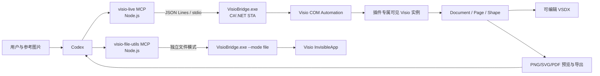
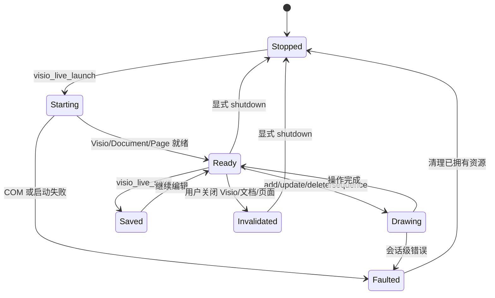

# Visio Scientific Illustrator 迁移设计

## 1. 文档信息

- 日期：2026-07-22
- 目标项目：将 `icebird1998/drawio-scientific-illustrator` 迁移为可实时控制 Microsoft Visio 的 Codex 插件
- 已确认方案：方案 A，保留 Node.js MCP 层，新增常驻 C#/.NET Visio COM Bridge
- 目标平台：Windows x64、桌面版 Microsoft Visio
- 本机验证环境：Visio COM 已注册，Office16，Visio x64，版本 `16.0.20131.20154`
- 设计状态：已确认总体技术路线，等待用户审阅本文档后进入详细实施计划

## 2. 目标与非目标

### 2.1 目标

1. Codex 能启动一个插件专属、用户可见的 Visio 窗口。
2. 形状、文字、连接线、样式和位置按步骤出现在 Visio 页面中。
3. 用户可以在绘制过程中观察进度，也可以在 Visio 中手工移动、编辑或删除图形。
4. Codex 能检查当前页面、定位已有图形并进行精确修改。
5. 所有可表达内容均使用真实 Visio Shape、文字和已胶合连接线，而不是把完整结果扁平化成图片。
6. 完成后保存完整、可编辑的 `.vsdx`，并导出 PNG、SVG 或 PDF 交付物。
7. 尽可能复用原项目的 Codex 插件结构、MCP JSON-RPC 外壳、工具工作流和 Skill 设计思想。
8. 修复原项目中已经发现的并发、覆盖写入、活动页快照和测试覆盖问题。

### 2.2 非目标

1. 第一版不支持 macOS、Linux 或 Visio 网页版。
2. 第一版不接管用户已经打开的任意 Visio 进程或文档。
3. 第一版不直接修改 `.vsdx` ZIP/XML 包来完成绘图。
4. 第一版不支持包含宏的 `.vsdm`，只接受 `.vsdx`。
5. 第一版不实现 VSTO 加载项、Ribbon 或 Visio 内嵌任务窗格。
6. 第一版不承诺把显微照片、热图、复杂曲线或分子渲染完全转换为 Visio 矢量图元。
7. 不通过操作系统级鼠标、键盘或屏幕坐标自动化控制 Visio。

## 3. 原项目实现概述

原项目由以下部分组成：

1. Codex marketplace 和插件清单。
2. `drawio-live` MCP：启动带 CDP 调试端口的 draw.io Electron 应用，通过 `Runtime.evaluate` 找到内部 Graph 对象并操作 `mxCell`。
3. `drawio-file-utils` MCP：构造、检查和修改未压缩的 draw.io XML，并调用 draw.io CLI 导出文件。
4. Skill：约束 Codex 先视觉拆图，再逐步绘制、截图检查、局部修正、保存和导出。
5. Node.js 语法、仓库结构和 MCP 初始化 smoke test。

Visio 不是 Electron 应用，没有可复用的 CDP 页面和 JavaScript Graph API。迁移时可保留 MCP 与 Skill 的上层工作流，但实时控制层和文件层必须重新实现。

## 4. 技术方案选择

### 4.1 采用方案

采用“Node MCP + C# COM Bridge”：



### 4.2 选择理由

1. Node MCP 可以复用原项目的 JSON-RPC、工具清单、图片内容返回和 Codex 插件装配方式。
2. C# 对 COM、STA 线程、Office Interop、消息过滤和异常类型支持更完整。
3. Bridge 通过标准输入输出通信，不开放 TCP 端口，权限边界比本地调试端口更小。
4. Bridge 崩溃时 Node MCP 可以返回明确的 `BRIDGE_EXITED`，不会向 Codex 输出损坏的半行 JSON。
5. 实时模式和文件模式共用一个 C# 核心库，但运行在不同进程，避免隐藏文件检查打断用户正在观看的页面。

## 5. 建议目录结构

```text
visio-scientific-illustrator/
├─ .agents/
│  └─ plugins/marketplace.json
├─ plugins/
│  └─ visio-scientific-illustrator/
│     ├─ .codex-plugin/plugin.json
│     ├─ .mcp.json
│     ├─ bin/
│     │  └─ win-x64/VisioBridge.exe
│     ├─ assets/
│     │  └─ visio-scientific-masters.vssx
│     ├─ bridge/
│     │  ├─ VisioBridge.sln
│     │  ├─ VisioBridge.Contracts/
│     │  ├─ VisioBridge.Core/
│     │  │  ├─ Session/
│     │  │  ├─ Commands/
│     │  │  ├─ Geometry/
│     │  │  ├─ Styling/
│     │  │  ├─ Export/
│     │  │  └─ Validation/
│     │  └─ VisioBridge.Host/
│     ├─ scripts/
│     │  ├─ mcp-common.mjs
│     │  ├─ bridge-client.mjs
│     │  ├─ live-server.mjs
│     │  └─ file-server.mjs
│     └─ skills/
│        └─ recreate-scientific-figure-in-visio/
│           ├─ SKILL.md
│           └─ agents/openai.yaml
├─ scripts/
│  ├─ validate-repo.mjs
│  ├─ smoke-test.mjs
│  └─ build-bridge.ps1
├─ install.ps1
├─ README.md
├─ PRIVACY.md
└─ package.json
```

### 5.1 目录约束

- 发布包内提供自包含的 `win-x64` Bridge，普通用户不需要安装 .NET SDK。
- 源码开发时由 `build-bridge.ps1` 调用固定版本的 .NET SDK 构建。
- 复杂形状只使用插件自带 `visio-scientific-masters.vssx` 中的通用 Master 名称，不依赖本机模板的中文或英文名称。
- 不把本机 Visio 绝对路径写入仓库；运行时通过 COM ProgID 检查 Visio。

## 6. 组件职责

### 6.1 `live-server.mjs`

- 实现 MCP 初始化、工具列表和工具调用。
- 启动并监控一个 `VisioBridge.exe --mode live` 子进程。
- 对所有修改状态的请求执行严格串行队列。
- 在请求进入 Bridge 前执行完整参数校验。
- 管理可见绘制节奏和 `step_delay_ms`。
- 将 Bridge 返回的 PNG 字节转换为 MCP 图片内容。
- Bridge 非正常退出时使当前会话失效，不自动创建另一个 Visio 会话。

### 6.2 `file-server.mjs`

- 提供保存后文件的检查和导出工具。
- 使用独立 `VisioBridge.exe --mode file`，内部创建 `Visio.InvisibleApp`。
- 不操作实时会话中的 COM 对象。
- 不直接用正则表达式修改 VSDX 内部 XML。

### 6.3 `VisioBridge.Host`

- 标准输入只读取逐行 JSON 请求，标准输出只写逐行 JSON 响应。
- 日志只写标准错误，禁止污染协议输出。
- 控制请求在专用 STA 线程上依次执行。
- STA 线程保持 Windows 消息泵，避免 COM 调用和 Visio UI 饿死。
- 注册有界 `IMessageFilter`，只处理明确的 COM busy/retry-later 状态。

### 6.4 `VisioSession`

- 创建插件专属的 `Visio.InvisibleApp`，随后将 `Visible` 设置为 true。
- 记录插件拥有的 Visio Process ID、Document ID、Page ID 和会话 ID。
- 只退出自己创建的 Visio 实例。
- 第一版不通过 ROT/GetActiveObject 接管现有用户进程。
- 用户主动关闭 Visio、文档或活动页时，将状态改为 `invalidated`。

### 6.5 `ShapeRepository`

- 不长期缓存 `Shape` RCW 作为唯一事实来源。
- 每个 Shape 写入 `User.CodexId`，并设置可识别的 `NameU`。
- 内存只缓存 `semanticId -> Shape.ID` 提示；每次修改前重新验证。
- 如果用户复制形状导致相同 `User.CodexId`，返回 `DUPLICATE_SEMANTIC_ID`，不猜测目标。
- 如果用户删除或替换目标，返回 `SHAPE_NOT_FOUND`。

### 6.6 `StyleMapper`

- 将工具参数中的颜色、字号、线宽和透明度转换为 ShapeSheet `FormulaU`。
- 只使用 `CellsU`、`CellExistsU` 和 `FormulaU`。
- 标签文字使用 `Shape.Text` 或 Characters API，不把用户文字拼接进 ShapeSheet 公式。
- 写入前验证颜色、数值范围和单元格存在性。

## 7. Node 与 Bridge 通信协议

### 7.1 请求

```json
{
  "id": 17,
  "command": "add_shape",
  "params": {
    "semantic_id": "encoder_block",
    "shape": "rounded_rectangle",
    "x": 120,
    "y": 80,
    "width": 240,
    "height": 100
  }
}
```

### 7.2 成功响应

```json
{
  "id": 17,
  "ok": true,
  "result": {
    "semantic_id": "encoder_block",
    "shape_id": 12,
    "name_u": "Codex_encoder_block"
  }
}
```

### 7.3 错误响应

```json
{
  "id": 17,
  "ok": false,
  "error": {
    "code": "SHAPE_NOT_FOUND",
    "message": "未找到语义 ID 为 encoder_block 的 Visio Shape。",
    "retryable": false,
    "details": {}
  }
}
```

### 7.4 协议规则

- `id` 在一个 Bridge 进程内唯一。
- 响应必须与请求 `id` 对应，但状态修改请求仍严格串行。
- Bridge 启动后先发送一条 `ready` 消息，包含 Bridge 版本、进程位数和检测到的 Visio 版本。
- 单条协议消息设置大小上限，默认 8 MiB；大图片预览使用临时文件路径传给 Node，不直接塞入 Bridge JSON。
- Node 读取、编码图片后立即清理该会话创建的临时文件。
- 不允许未知 command、未知字段或缺失字段静默通过。

## 8. 会话生命周期



### 8.1 启动模式

`visio_live_launch` 只接受明确模式：

- `mode="new"`：创建空白文档。
- `mode="open"`：必须提供现有 `.vsdx` 的绝对路径。

不提供“如果失败就连接现有 Visio”的隐式 fallback。请求与实际行为不一致时直接报错。

### 8.2 关闭策略

- `visio_live_close_document`：需要显式指定 `save`、`discard` 或 `cancel`；未首次保存的文档选择 `save` 时必须先调用 `visio_live_save` 提供路径。
- `visio_live_shutdown`：需要 `confirm=true` 和显式 `dirty_action=save|discard|cancel`；只关闭插件拥有的实例。`discard` 是唯一允许将 `Document.Saved` 标记为 true 后关闭的分支，因为用户已经明确授权丢弃修改。
- MCP 进程异常退出时，不强制结束仍可见的 Visio；记录恢复信息并让用户决定是否保留窗口。
- 正常退出时释放页面、文档和应用引用，避免残留后台 `VISIO.EXE`。

## 9. MCP 工具设计

### 9.1 实时工具

#### `visio_live_launch`

- 参数：`mode`、`file_path`、`page_name`、`canvas`、`step_delay_ms`、`maximize`、`include_preview`。
- `canvas` 使用像素宽高和固定 DPI，默认 `1600 x 1000 @ 96 DPI`。
- 返回：会话 ID、进程 ID、Visio 版本、文档、页面、画布和预览。

#### `visio_live_status`

- 返回：Bridge 状态、Visio 是否可见、Document/Page、Shape 数量、连接数量、保存状态和页面尺寸。

#### `visio_live_clear`

- 必须传入 `confirm=true`。
- 只删除当前活动页顶层及其组内由页面拥有的绘图 Shape，不删除其他页面。
- 一个撤销作用域对应一次清空操作。

#### `visio_live_add_shape`

- 必填：`semantic_id`、`shape`、`x`、`y`、`width`、`height`。
- 可选：`label`、填充、线条、文字样式、旋转、圆角、透明度、图层。
- 支持：rectangle、rounded_rectangle、ellipse、diamond、cylinder、hexagon、triangle、parallelogram、cloud、text、master。
- rectangle/ellipse/text 优先使用 Visio 原生绘图 API。
- 复杂形状从插件自带 stencil 通过通用 Master 名称 Drop。
- Master 缺失时返回 `MASTER_NOT_FOUND`，不得退化成矩形。

#### `visio_live_add_image`

- 输入 PNG、JPEG、SVG 或 EMF 的绝对路径。
- 使用 `Page.Import` 生成可移动、可缩放的图片 Shape。
- 图片内容仍是栅格或嵌入对象，工具结果和最终交付说明必须明确标记。

#### `visio_live_add_connector`

- 必填：`semantic_id`、`source`、`target`。
- 可选：标签、线色、线宽、虚线、箭头、路由、连接点和 waypoints。
- 使用真正的 1D Shape。
- BeginX/EndX 必须 GlueTo 目标 Shape 或连接点。
- 创建后检查 `Page.Connects`，确认两端真实胶合。

#### `visio_live_update_shape`

- 按 `semantic_id` 修改标签、位置、尺寸、角度和样式。
- 修改前重新解析 Shape，不直接信任旧 COM 引用。
- 如果用户手动移动过 Shape，只修改请求明确给出的字段。

#### `visio_live_delete_shape`

- 删除指定语义 ID 的 Shape。
- 必须显式提供 `connector_policy="keep"` 或 `connector_policy="delete"`；不自动猜测是否删除相关连接线。
- 操作前返回或记录受影响连接线清单。
- 操作进入撤销栈。

#### `visio_live_draw_sequence`

- 顺序执行 shape、image、connector、update、delete、fit 和 wait。
- `step_delay_ms` 必须为非零值，建议 400–1000 ms。
- 每个操作单独进入 Visio 模型和撤销栈，使用户能观察并逐步撤销。
- 中途失败立即停止，返回失败索引和已经成功的操作，不继续执行剩余操作。

#### `visio_live_inspect`

- 返回 Shape 的 semantic ID、Visio ID、NameU、文本、Master、页面坐标、尺寸、角度、样式摘要、组/容器、图层和连接关系。
- 支持限制最大返回数量。
- 对组递归检查，但对外统一返回页面坐标。

#### `visio_live_fit`

- 使用 `Window.ViewFit` 设置 fit page 或 fit width。
- 只操作绘图窗口；窗口类型不匹配时返回明确错误。

#### `visio_live_preview`

- 将当前页导出到会话临时目录中的 PNG。
- 导出前保存 Visio ApplicationSettings 的栅格设置，导出后无条件恢复。
- 默认宽度 2000 px，成功解码 PNG 后再返回 MCP 图片。
- 不使用操作系统屏幕截图。

#### `visio_live_save`

- 输出必须为绝对 `.vsdx` 路径。
- 默认 `overwrite=false`。
- 首次保存使用 `Document.SaveAsEx`；后续同路径保存使用 `Document.Save`。
- 覆盖既有文件时先创建同目录备份；保存和验证成功后才删除备份。
- 保存失败时恢复原文件，并把恢复结果写入错误详情。

#### `visio_live_close_document` / `visio_live_shutdown`

- 明确管理文档和插件拥有的 Visio 实例生命周期。

### 9.2 文件工具

#### `visio_validate`

- 使用独立 `Visio.InvisibleApp` 打开 `.vsdx`。
- 检查文件可打开、页面存在、Shape ID 可枚举、语义 ID 唯一、连接线端点有效、页面尺寸有效。
- 关闭检查文档，不修改源文件。

#### `visio_inspect_file`

- 返回保存文件的页面和 Shape 清单，输出格式与 `visio_live_inspect` 尽量一致。

#### `visio_export`

- 支持 PNG、SVG、PDF。
- PNG 和 SVG 使用 `Page.Export`；PDF 使用 `Document.ExportAsFixedFormat`，并通过 print range 明确导出当前页或全部前景页。
- 导出到同目录临时文件，验证输出后原子替换最终路径。
- 如果覆盖导出失败，必须保留旧文件。
- 第一版不提供直接离线修改 VSDX 的 `update_file`；目标修改应通过实时 Visio 会话完成。

## 10. 坐标与几何模型

### 10.1 对外坐标

- MCP 参数继续使用类似 draw.io 的左上角像素坐标。
- 画布由 `width_px`、`height_px`、`dpi` 定义。
- 所有顶层 Shape 的 x/y 表示左上角，width/height 表示外接框。

### 10.2 Visio 坐标转换

Visio 页面通常使用左下角原点和英寸内部单位：

```text
pin_x_in = (x_px + width_px / 2) / dpi
pin_y_in = (canvas_height_px - y_px - height_px / 2) / dpi
width_in = width_px / dpi
height_in = height_px / dpi
```

- PageWidth/PageHeight 与画布尺寸保持一致。
- 读取 Shape 时执行逆变换。
- waypoint、图片和自由曲线使用同一转换器。
- 组内坐标不能直接当页面坐标；检查时必须使用 Visio 变换接口转换为页面坐标。
- 所有浮点比较使用容差，不能直接判断二进制浮点完全相等。

## 11. Shape、Master 与样式映射

### 11.1 基本 Shape

| 抽象类型 | Visio 实现 |
|---|---|
| rectangle | `Page.DrawRectangle` |
| ellipse | `Page.DrawOval` |
| text | 无填充、无线条的 2D Shape + `Shape.Text` |
| polyline | `Page.DrawPolyline` |
| image | `Page.Import` |
| connector | 1D Shape + `GlueTo` |
| rounded/cylinder/cloud 等 | 自带 stencil 的 Master + `Page.Drop` |

### 11.2 ShapeSheet 映射

| MCP 属性 | ShapeSheet 通用单元格 |
|---|---|
| x/y | PinX / PinY |
| width/height | Width / Height |
| rotation | Angle |
| fill color | FillForegnd |
| fill opacity | FillForegndTrans |
| stroke color | LineColor |
| stroke width | LineWeight |
| dashed | LinePattern |
| font color | Char.Color |
| font size | Char.Size |
| horizontal align | Para.HorzAlign |
| vertical align | VerticalAlign |
| begin/end arrow | BeginArrow / EndArrow |

### 11.3 写入安全

- 颜色只接受标准十六进制并转换为受控 `RGB(r,g,b)` 公式。
- 数字写入 `FormulaU` 时显式添加通用单位，如 `in`、`pt`、`deg`。
- 访问任何可选 Cell 前调用 `CellExistsU`。
- 不接受任意 ShapeSheet 公式作为默认公开参数，防止公式注入和跨语言差异。
- 高级用户样式扩展应另设受限工具，而不是把任意公式混入基础工具。

## 12. 撤销、并发和用户手工编辑

### 12.1 撤销

- 每次单工具操作使用 `BeginUndoScope` 和 `EndUndoScope`。
- 成功时 commit，失败时以不提交结束该 scope。
- sequence 中每一步一个 scope，不把整个长序列包成一个不可观察的大事务。

### 12.2 并发

- Node 端使用单一 Promise 请求队列。
- Bridge 端使用单一 STA 命令队列作为第二道保护。
- 只读 inspect 也进入同一 COM 队列，避免读取时用户操作与写请求交叉导致引用失效。
- 不允许两个 live MCP 进程共享同一个 Bridge 或 Visio 实例。

### 12.3 用户中途编辑

- 用户移动 Shape 后，后续只修改显式指定的字段。
- 用户删除 Shape 后返回 `SHAPE_NOT_FOUND`。
- 用户复制 Shape 后如出现重复语义 ID，返回 `DUPLICATE_SEMANTIC_ID`。
- 用户切换活动页时不自动跟随；工具必须显式选择页面或继续使用会话绑定页面。
- 用户打开模态对话框时，COM busy 重试到达上限后返回 `VISIO_BUSY`，不无限等待。

## 13. 保存、导出和验证安全

### 13.1 原则

- 默认不覆盖现有文件。
- 输出路径必须是绝对路径和允许的扩展名。
- 临时文件必须位于最终文件同一卷，确保最终替换具备原子性条件。
- 只删除本次会话明确创建的临时文件。
- 保存或导出失败时不得删除用户原有文件。

### 13.2 保存流程

1. 检查输出路径和覆盖策略。
2. 如果目标存在且允许覆盖，创建带会话 ID 的备份。
3. 调用 Visio Save/SaveAsEx。
4. 通过独立文件模式重新打开并验证。
5. 验证通过后删除备份。
6. 任一步失败则恢复备份并报告恢复状态。

### 13.3 预览导出流程

1. 保存当前 ApplicationSettings 中相关导出设置。
2. 设置临时 PNG 所需尺寸和分辨率。
3. 调用 `Page.Export`。
4. 检查文件存在、尺寸非零、PNG 可解码。
5. 在 finally 中恢复 Visio 导出设置。
6. Node 读取图片并删除临时文件。

## 14. Skill 全量迁移设计

Skill 不能简单执行字符串替换。应按以下四类处理。

### 14.1 保留并改写

- 可见画布逐步绘制。
- 禁止 OS 鼠标和键盘自动化。
- 先拆解参考图，再创建可编辑图元。
- 分逻辑区域预览和检查。
- 使用稳定语义 ID。
- 完成实时图后再保存最终源文件。
- 不确定内容必须报告，不能编造。

### 14.2 语义替换

| draw.io 概念 | Visio 概念 |
|---|---|
| Graph API | Visio COM Automation Object Model |
| mxCell | Shape |
| vertex | 2D Shape |
| edge | 1D Connector |
| style string | ShapeSheet CellsU/FormulaU |
| default parent | Page、Layer、Group 或 Container |
| graph inspect | Page.Shapes / Page.Connects |
| graph fit | Window.ViewFit |
| renderer screenshot | Page.Export 临时 PNG |
| mxCodec snapshot | Document.SaveAsEx |
| `.drawio` | `.vsdx` |

### 14.3 删除

- Electron、CDP、localhost 调试端口和 profile 目录。
- graph-ready、事件闭包 Graph 恢复逻辑。
- mxGraph XML、压缩页面和 XML-first 专属措辞。
- `.drawio.png`、XML 嵌入 PNG 和 draw.io CLI。
- PNG IEND 修复。

### 14.4 新增

- Windows 和本地 Visio COM 前提。
- 插件专属 Visio 实例及所有权边界。
- STA 串行队列和 COM busy 有界重试。
- 左上角像素与左下角英寸的坐标转换。
- `User.CodexId`、NameU、CellsU 和 FormulaU。
- 真正胶合的 1D 连接线。
- Master 通用名称和插件自带 stencil。
- 用户中途手工编辑后的重新 inspect。
- 导出设置保存和恢复。
- 保存旧文件保护和验证。
- 不进行自动接口 fallback；能力不支持时明确报错。

### 14.5 建议的 SKILL.md 内容

```markdown
---
name: recreate-scientific-figure-in-visio
description: Recreate, trace, revise, inspect, save, or export scientific figures live inside a visible Microsoft Visio desktop document through Visio COM automation. Use when the user wants to watch editable Visio shapes, text, images, and glued connectors appear step by step, refine an existing live page, or receive final VSDX and exported deliverables.
---

# Recreate Scientific Figures in Microsoft Visio

Use the visio_live_* MCP tools for visible drawing and use visio_validate, visio_inspect_file, and visio_export only after the live document has been saved.

## Hard boundaries

- Control only the plugin-owned Microsoft Visio instance through Visio COM automation.
- Never use operating-system mouse, keyboard, or general screen automation.
- Never construct a VSDX package first and open it as the live drawing method.
- Never import a completed screenshot or SVG and claim it is an editable reconstruction.
- Page-export previews are allowed only to inspect the active Visio page.
- Do not attach to or close an unrelated user-owned Visio instance.
- Do not silently replace a missing Master or unsupported operation with another shape.

## Workflow

1. Inspect every supplied reference with vision. Render the relevant PDF page first when necessary.
2. Decompose the reference into editable Visio primitives: page, panels, 2D Shapes, text, 1D connectors, groups, containers, legends, images, colors, typography, line weights, z-order, and routing.
3. Call visio_live_launch with an explicit new/open mode and a visible nonzero step delay. Require a ready document and page before drawing.
4. Use stable semantic IDs. The bridge stores them in User.CodexId and NameU.
5. Add shapes and images first, then add connectors whose endpoints are glued to real Shapes.
6. After each logical section, call visio_live_preview and compare the exported page with the reference.
7. Before targeted corrections, call visio_live_inspect because the user may have edited the page manually.
8. Update only requested fields so manual adjustments are preserved.
9. Use visio_live_fit to keep the active page visible.
10. After the visible figure is complete, call visio_live_save. This is the first final VSDX save for a newly created document.
11. Call visio_validate and export a 2000 px review PNG. Check wording, element count, topology, glued endpoints, alignment, overlap, clipping, z-order, color, whitespace, and correspondence to the reference.
12. After approval, export the requested final deliverables.

## Visio-specific fidelity rules

- Treat tool coordinates as top-left pixels; do not pre-convert them to Visio inches.
- Recreate text as editable Shape text and arrows as glued 1D connectors.
- Use universal ShapeSheet names and values; never rely on localized Cell or Master names.
- Use consistent Master families, line weights, fonts, arrowheads, and semantic colors.
- Route connectors around unrelated Shapes and inspect Page.Connects after creation.
- For photographs, microscopy, heatmaps, molecular renders, or dense plots, use an explicit image Shape and disclose that the internal pixels are not editable Visio geometry.
- If the reference is ambiguous or unreadable, state the uncertain parts instead of inventing content.
- If a capability is unavailable, return the limitation; do not use an unrelated fallback.

## Delivery

Return clickable paths for the VSDX source and every export. State validation status, Visio version, page count, Shape count, connector count, and any intentionally rasterized portions.
```

## 15. 原项目缺陷及迁移处置

| 优先级 | 原项目问题 | 风险 | Visio 版本处置 |
|---|---|---|---|
| P0 | 覆盖导出失败后删除输出路径 | 用户旧文件可能丢失 | 临时文件、备份、验证、原子替换 |
| P1 | `readline` 异步处理没有请求队列 | 多个 tools/call 可并发改图 | Node 队列 + Bridge STA 队列 |
| P1 | `file_path` 在已有 target 时可能被忽略 | 操作错误文档 | launch 模式显式、禁止静默接管 |
| P1 | live snapshot 只序列化当前 Graph | 多页和文档元数据丢失 | 保存完整 Visio Document |
| P1 | 直接覆盖写文件 | 中断时可能产生截断文件 | 保存备份及验证恢复 |
| P2 | 正则修改 XML | 复杂结构可能误改 | 只通过 Visio COM 修改 Shape |
| P2 | 追加 PNG IEND 视为修复 | 可能掩盖其他损坏 | 实际解码验证，不修改损坏文件 |
| P2 | 无正式 shutdown 和所有权管理 | 残留应用进程 | 显式生命周期和 owned PID |
| P2 | 工具 schema 未在服务端完整校验 | 非法参数进入内部实现 | Node 与 Bridge 双重校验 |
| P2 | CI 只测 initialize/tools/list | 无真实绘图保障 | Windows 分层集成测试 |
| P3 | 保存 XML 写死 draw.io 版本 | 元数据可能与实际应用不一致 | 由 Visio 自身生成 VSDX |

## 16. Visio 新增风险及防护

| 风险 | 表现 | 防护 |
|---|---|---|
| COM 非 STA 调用 | RPC 错误、UI 卡死 | 专用 STA 线程和消息泵 |
| Visio 忙或显示模态框 | RPC_E_CALL_REJECTED | IMessageFilter 有界重试，超时返回 VISIO_BUSY |
| RCW 生命周期错误 | Visio 残留或访问冲突 | 明确所有权、短生命周期 Shape 引用、按序释放 |
| 用户手工删除/复制 | Shape 引用失效或 ID 重复 | 每次重解析 User.CodexId，拒绝猜测 |
| 本地化差异 | 中文版找不到 Cell/Master | 仅使用 CellsU/FormulaU/NameU 和自带 stencil |
| 坐标系差异 | 上下颠倒、尺寸错误 | 单一 GeometryConverter 和逆变换测试 |
| 连接线未胶合 | 移动节点后连线断开 | GlueTo 后检查 Page.Connects |
| 导出设置是全局状态 | 改变用户后续导出行为 | 导出前快照，finally 恢复 |
| 保存覆盖失败 | 旧 VSDX 损坏或丢失 | 备份、验证和恢复 |
| 用户关闭窗口 | COM 对象失效 | 状态失效检测，明确错误，不自动重启 |
| 多 Visio 产品共存 | 版本和能力不确定 | 启动握手报告实际版本和产品能力 |
| Bridge 位数不匹配 | 启动或 COM 绑定失败 | 首版发布 win-x64，与本机 Visio x64 对齐 |
| 临时文件泄漏 | 磁盘残留预览 | 会话专属目录，只清理自身文件 |

## 17. 错误模型

建议稳定错误码：

- `VISIO_NOT_INSTALLED`
- `VISIO_START_FAILED`
- `VISIO_BUSY`
- `SESSION_NOT_READY`
- `SESSION_INVALIDATED`
- `DOCUMENT_NOT_FOUND`
- `PAGE_NOT_FOUND`
- `SHAPE_NOT_FOUND`
- `DUPLICATE_SEMANTIC_ID`
- `MASTER_NOT_FOUND`
- `CELL_NOT_FOUND`
- `CONNECTOR_NOT_GLUED`
- `INVALID_COORDINATES`
- `INVALID_STYLE`
- `OUTPUT_EXISTS`
- `SAVE_FAILED`
- `VALIDATION_FAILED`
- `EXPORT_FAILED`
- `BRIDGE_TIMEOUT`
- `BRIDGE_EXITED`
- `UNSUPPORTED_OPERATION`

错误不得只返回原始 COM HRESULT。响应同时提供稳定错误码、中文可读信息、底层 HRESULT/异常类型和是否可重试。

## 18. 安全与隐私

1. Node 与 Bridge 仅使用父子进程 stdio，不监听网络端口。
2. 不包含遥测、分析或远程服务。
3. 参考图片、VSDX 和预览文件默认保留在本机。
4. 只支持绝对路径，并验证扩展名和文件存在性。
5. 第一版拒绝宏启用格式，降低打开不受信文件的风险。
6. 插件只退出自己创建的 Visio Process ID。
7. 删除只作用于明确的当前页面 Shape 或本次会话临时目录。
8. 日志中不记录图片内容、完整文档内容或敏感 Shape 文本；只记录操作类型、语义 ID 和错误摘要。

## 19. 构建与安装

### 19.1 开发构建

- Node.js 22+。
- .NET 8 SDK。
- 本机安装 Microsoft Visio，用于 COM 集成测试。
- C# 使用 Visio Primary Interop 类型或由 Visio type library 生成的固定 Interop 引用。

### 19.2 发布构建

- 发布自包含 `win-x64` Bridge。
- CI 校验 Bridge SHA-256 并在插件包中固定版本。
- `.mcp.json` 分别启动 `live-server.mjs` 和 `file-server.mjs`。
- Node 脚本根据插件相对路径启动 Bridge，不使用用户目录硬编码。

### 19.3 安装脚本

`install.ps1` 应：

1. 检查 Git 和 Codex CLI。
2. 检查 `Visio.Application` 或 `Visio.InvisibleApp` COM ProgID。
3. 检查插件自带 Bridge 是否存在且位数正确。
4. 注册本地 marketplace 和插件。
5. 提醒重启 Codex 并创建新任务。

第一版不提供可运行的 `install.sh`，README 明确说明仅支持 Windows。

## 20. 测试策略

遵循分层测试，避免把“工具能列出来”误当成“Visio 能绘图”。

### 20.1 无 Visio 单元测试

- 坐标正向和逆向转换。
- 颜色、单位、样式参数校验。
- JSON Lines 分包和异常处理。
- MCP 请求串行队列。
- Bridge 错误到 MCP 错误映射。
- 覆盖保存和导出的备份/恢复状态机。
- semantic ID 规范化和重复检测。

### 20.2 Bridge 合约测试

- 使用 `IVisioAdapter` 假实现测试命令处理。
- 验证每个 command 的参数和结果 DTO。
- 验证 sequence 中途失败会停止并返回正确索引。
- 验证 shutdown 不会关闭非 owned PID。

### 20.3 Windows + Visio 集成测试

1. 启动可见专属 Visio。
2. 创建矩形、椭圆、文字和 Master Shape。
3. 创建并胶合连接线。
4. 移动节点后确认连接线仍连接。
5. 手工模拟删除和复制后检查错误。
6. 导出并解码 2000 px PNG。
7. 保存 `.vsdx`，独立重新打开验证。
8. 构造保存/导出失败，确认旧文件仍存在且内容未变。
9. 关闭用户可见窗口，确认会话进入 invalidated。
10. 正常 shutdown 后确认插件拥有的 Visio 进程退出。

### 20.4 人工验收

- 用户能够清楚看到每一步出现。
- Visio 内可单独选中和编辑文字、Shape、图片和连接线。
- 撤销栈能按逻辑步骤回退。
- 用户手工调整后 Codex 不会无意覆盖未请求字段。
- 交付 VSDX 在关闭插件后仍能正常打开编辑。

## 21. 分阶段实施

### 阶段 1：仓库改名和插件骨架

- 新建 Visio 插件目录、manifest、MCP 配置和 Skill 占位结构。
- 保留原项目版权和 MIT 许可证要求。
- 完成 Windows-only 安装与环境检查设计。

### 阶段 2：C# Bridge 最小闭环

- 建立 stdio JSON Lines 协议。
- 创建专属可见 Visio 实例和空白 Document。
- 实现 status、add rectangle、fit、shutdown。

### 阶段 3：实时绘图核心

- 完成 ShapeRepository、坐标转换、样式映射、文字和基础 Shape。
- 完成 Connector 和 GlueTo 验证。
- 完成 inspect、update、delete、clear 和 draw_sequence。

### 阶段 4：预览、保存和文件工具

- 完成 PNG 预览和导出设置恢复。
- 完成 VSDX 保存、备份、验证和恢复。
- 完成独立 file mode 的 validate、inspect 和 export。

### 阶段 5：复杂科研图元

- 创建并打包通用 Master stencil。
- 支持 cylinder、cloud、hexagon、container、group 和常用科研面板。
- 支持显式图片 Shape 和栅格披露。

### 阶段 6：Skill、文档与质量加固

- 替换 Skill 为本文第 14 节设计。
- 更新 README、PRIVACY、CHANGELOG 和默认提示词。
- 完成 Windows 分层测试、故障注入和安装验证。

## 22. 验收标准

满足以下条件才视为迁移完成：

1. Codex 能启动插件拥有的可见 Visio 实例。
2. 用户能观察至少形状、文字和连接线逐步出现。
3. 所有 MCP 状态修改请求严格串行。
4. Shape 具有可恢复的 `User.CodexId`，重开文件后仍可检查。
5. 连接线是已胶合 1D Shape，移动节点后保持连接。
6. 用户手工修改后，inspect 能反映最新状态。
7. preview 返回可解码图片且不永久改变 Visio 导出设置。
8. 保存生成完整 `.vsdx`，多页面文档不被缩减为活动页。
9. 覆盖保存或导出失败不会丢失旧文件。
10. validate 能在独立 Visio 文件模式中重新打开交付文件。
11. Skill 中不存在未分类的 draw.io/CDP/mxGraph 专属约束。
12. 插件不会接管或关闭无关的用户 Visio 实例。
13. 正常关闭后不残留插件拥有的后台 Visio 进程。
14. Node smoke test、Bridge 合约测试和 Windows Visio 集成测试全部通过。

## 23. 参考资料

- 原项目仓库：[icebird1998/drawio-scientific-illustrator](https://github.com/icebird1998/drawio-scientific-illustrator)
- Visio `Application.Visible`：[Microsoft Learn](https://learn.microsoft.com/en-us/office/vba/api/visio.application.visible)
- Visio `Page.DrawRectangle`：[Microsoft Learn](https://learn.microsoft.com/en-us/office/vba/api/visio.page.drawrectangle)
- Visio `Page.Drop`：[Microsoft Learn](https://learn.microsoft.com/en-us/office/vba/api/visio.page.drop)
- Visio `Page.DrawPolyline`：[Microsoft Learn](https://learn.microsoft.com/en-us/office/vba/api/visio.page.drawpolyline)
- Visio `Connect` 与 `GlueTo`：[Microsoft Learn](https://learn.microsoft.com/en-us/office/vba/api/visio.connect)
- Visio `Shape.NameU`：[Microsoft Learn](https://learn.microsoft.com/en-us/office/vba/api/visio.shape.nameu)
- Visio `Shape.AddNamedRow`：[Microsoft Learn](https://learn.microsoft.com/en-us/office/vba/api/visio.shape.addnamedrow)
- Visio `Window.ViewFit`：[Microsoft Learn](https://learn.microsoft.com/en-us/office/vba/api/visio.window.viewfit)
- Visio `Application.BeginUndoScope`：[Microsoft Learn](https://learn.microsoft.com/en-us/office/vba/api/visio.application.beginundoscope)
- Visio `Document.SaveAsEx`：[Microsoft Learn](https://learn.microsoft.com/en-us/office/vba/api/visio.document.saveasex)
- Visio `Document.ExportAsFixedFormat`：[Microsoft Learn](https://learn.microsoft.com/en-us/office/vba/api/visio.document.exportasfixedformat)
- Visio `ApplicationSettings`：[Microsoft Learn](https://learn.microsoft.com/en-us/office/vba/api/visio.applicationsettings)
- COM `IMessageFilter`：[Microsoft Learn](https://learn.microsoft.com/en-us/windows/win32/api/objidl/nn-objidl-imessagefilter)
- .NET COM RCW 释放注意事项：[Microsoft Learn](https://learn.microsoft.com/en-us/dotnet/api/system.runtime.interopservices.marshal.releasecomobject)
